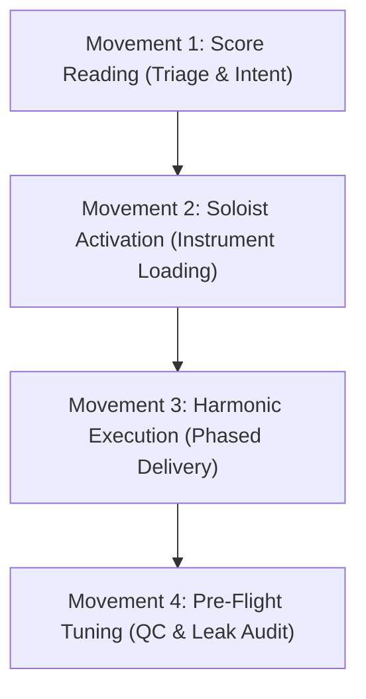

# ORCHESTRATOR: Master Orchestra Protocol

Dokumen ini adalah protokol utama bagi AI / Agent dalam mengelola pengembangan sistem pada repositori **Asterisk** (`*`) — Platform Manajemen Kredensial Multi-Klien, Sesi Showing Klien HRIS, dan Showing Mode Anti-Leak.

Setiap tugas yang diberikan pengguna harus melalui alur berpikir simfoni orkestra dan koordinasi peran yang terstandarisasi di bawah ini.

---

## 1. Prinsip Utama Orkestrasi Asterisk

1. **Strict Soloist & Ensemble Routing:**  
   Jangan langsung mengeksekusi kode sebelum mengetahui domain tugas. Buka [OVERTURE.md](OVERTURE.md) untuk memahami prinsip filosofi dasar dan [ARRANGEMENT.md](ARRANGEMENT.md) untuk menentukan instrumen orkestra mana yang wajib memimpin (*soloist*):
   - Scope / Tiket PM ➔ Panggil **BATON** ([BATON.md](BATON.md)).
   - UI / Web Layout ➔ Panggil **VIOLINIST** ([VIOLINIST.md](VIOLINIST.md)).
   - Kanvas FigCraft ➔ Panggil **ARTIST** ([ARTIST.md](ARTIST.md)).
   - Backend API & DB ➔ Panggil **CELLIST** ([CELLIST.md](CELLIST.md)).
   - Regulasi HRIS / Pajak ➔ Panggil **FLUTIST** ([FLUTIST.md](FLUTIST.md)).
   - Kontrak Eden Treaty ➔ Panggil **HARPIST** ([HARPIST.md](HARPIST.md)).
   - Keamanan & Vault ➔ Panggil **PERCUSSIONIST** ([PERCUSSIONIST.md](PERCUSSIONIST.md)).
   - Standar Kode & Anti-Slop ➔ Panggil **TUNER** ([TUNER.md](TUNER.md)).
   - Pengujian & Anti-Leak ➔ Panggil **AUDITOR** ([AUDITOR.md](AUDITOR.md)).

2. **Mandatory Skill Loading:**  
   Sebelum menulis kode atau file konfigurasi, panggil `read_file` pada file `SKILL.md` dari skill yang terpilih di `.agents/skills/<nama-skill>/SKILL.md`.

3. **Showing Mode First (Zero Data Leak):**  
   Setiap tampilan antarmuka dan endpoint data wajib memperhitungkan status **Showing Mode** (`Ctrl+Shift+S`). Tidak boleh ada credential rahasia yang terekspos tanpa proteksi saat demo live.

4. **Full Output Enforcement:**  
   Dilarang memotong kode dengan placeholder `// ... rest of code` atau `// TODO`. Seluruh kode harus ditulis secara lengkap dan siap pakai sesuai skill `full-output-enforcement`.

---

## 2. 4 Langkah Siklus Simfoni (*The 4-Movement Lifecycle*)

### Movement 1: Score Reading (Triage & Intent)
Menganalisis prompt pengguna untuk menentukan domain:
* Apakah ini tugas **Showing Mode & Keamanan Vault**? ➔ `PERCUSSIONIST`
* Apakah ini tugas **Desain Kanvas / UI Visual**? ➔ `ARTIST` & `VIOLINIST`
* Apakah ini tugas **API Elysia / Skema Drizzle**? ➔ `CELLIST`
* Apakah ini tugas **Spesifikasi Fitur / Kebutuhan Klien**? ➔ `FLUTIST`
* Apakah ini tugas **Integrasi Kontrak Data**? ➔ `HARPIST`
* Apakah ini tugas **Manajemen Scope & Feedback Klien**? ➔ `BATON`

### Movement 2: Soloist Activation
Membaca file panduan instrumen terkait di `.agents/orchestra/<INSTRUMENT>.md` dan mengaktifkan skill yang diwajibkan melalui [ARRANGEMENT.md](ARRANGEMENT.md).

### Movement 3: Harmonic Execution
Jalankan pengerjaan secara bertahap mengikuti SOP pada [SCORE.md](SCORE.md).

### Movement 4: Pre-Flight Tuning
Sebelum mengembalikan hasil ke pengguna:
* Kode bersih dari bug linting/TypeScript (diawasi oleh `TUNER`).
* Bebas dari kebocoran data sensitif saat Showing Mode aktif (diawasi oleh `AUDITOR`).
* Sesuai dengan batasan verifikasi pengguna (server runtime dijalankan oleh pengguna, bukan agent mandiri).
