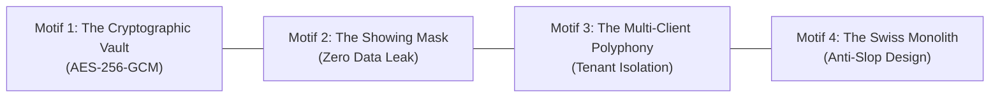

# OVERTURE: The Grand Architectural Prelude of Asterisk

> *"Sebelum tirai panggung tersingkap dan nada pertama dibunyikan, overture merajut seluruh tema utama dari simfoni yang akan datang: misteri brankas rahasia, elegansi topeng demo klien, dan keagungan monolit Swiss."*

---

## 🎼 1. Kisah & Visi Simfoni Asterisk

Sebagai Lead Project Manager yang mengelola implementasi berbagai sistem software dan aplikasi lintas korporasi klien vendor (Adaro Energy, Bank Mandiri, Telkomsel, Indofood), **Rey Cannavaro** menghadapi dilema klasik perusahaan teknologi:
1. **Kebocoran Rahasia Klien**: Kredensial database, port staging, dan token generator sering tersebar tidak aman di obrolan chat atau dokumen lokal.
2. **Kepanikan Live Showing**: Saat presentasi demo berkala (*weekly showing*) melalui *screenshare*, PM dan QA selalu was-was jika password asli atau host server privat tak sengaja tersorot di layar klien.
3. **Kekacauan Spreadsheet Feedback**: Catatan revisi klien dari sesi demo sering bertebaran di puluhan Google Sheets yang terputus dari antrean kerja para insinyur.

**Asterisk (`*`)** diciptakan sebagai konduktor tunggal yang menyelesaikan ketiga friksi tersebut dalam satu simfoni arsitektur modern berkinerja tinggi.

---

## 🎻 2. Empat Motif Musikal Asterisk (*The 4 Core Motifs*)

Setiap baris kode, kueri database, dan komponen antarmuka yang ditulis dalam repositori ini wajib tunduk pada empat motif agung:

### Motif 1: The Cryptographic Vault (Staccato & Kokoh)
Setiap rahasia teknis (password DB, SSH keys, generator secrets) wajib dilindungi oleh enkripsi **AES-256-GCM** dengan Initialization Vector (IV) 12-byte acak dan Authentication Tag 16-byte. Tidak ada plaintext credential yang boleh disimpan di basis data atau tercetak di terminal log.

### Motif 2: The Showing Mask (Piano & Anggun)
Ketika *Showing Mode* aktif (`Ctrl+Shift+S`), seluruh antarmuka dan transmisi data secara instan mengenakan topeng pelindung: kredensial berubah menjadi `••••••••••••`, host produksi di-masking, dan nama sensitif disamarkan. Klien hanya melihat keindahan fungsi tanpa pernah melihat rahasia infrastruktur.

### Motif 3: The Multi-Client Polyphony (Harmoni Multi-Tenant)
Setiap tenant/klien vendor adalah suara instrumen yang berbeda. Environment dev/staging/prod, kredensial vault, sesi demo, dan log feedback terisolasi secara ketat. Satu nada dari Klien A tidak boleh bocor atau mengaburkan partitur Klien B.

### Motif 4: The Swiss Monolith (Elegan & Anti-Slop)
Antarmuka Asterisk menolak tren murahan AI: tanpa gradien ungu neon, tanpa drop shadow kartun. Asterisk bernapas dalam disiplin *Swiss Modernism*: Carbon Obsidian (`#06080D`), Charcoal (`#18191E`), Slate (`#25272D`), Floating White Shell, dan aksen Tangerine Orange (`#FF6C22`) dengan layout super-ellipse halus (*TeamUnity Style*).

---

## ⚡ 3. Aksioma Tak Terbantahkan bagi Seluruh Musisi

1. **Partitur Di Atas Segalanya**: Jangan berspekulasi. Baca selalu [SCORE.md](SCORE.md) untuk SOP pekerjaan dan [ARRANGEMENT.md](ARRANGEMENT.md) untuk pemetaan skill.
2. **Kepatuhan Musisi**: Setiap musisi bertanggung jawab penuh atas kejernihan instrumennya:
   - `BATON`: Menjaga tempo dan ruang lingkup PRD.
   - `VIOLINIST`: Memastikan estetika melodi UI web dan responsivitas layar.
   - `ARTIST`: Mengarahkan kanvas FigCraft dan tata panggung visual.
   - `CELLIST`: Menjaga kekokohan basis data 13 tabel PostgreSQL dan API Elysia.
   - `PERCUSSIONIST`: Membentengi keamanan vault dan filter Showing Mode.
   - `FLUTIST`: Menjamin ketajaman analisis kebutuhan spesifikasi fitur dan dekonstruksi feedback klien.
   - `HARPIST`: Menjembatani frontend dan backend via Eden Treaty tanpa type error.
   - `TUNER`: Menyetem kode agar bersih dari lint error dan kode malas.
   - `AUDITOR`: Menantang akustik sistem dengan uji kebocoran data dan batas tenant.
3. **Kontrol Pengguna**: Dev server dan eksekusi runtime sepenuhnya dikendalikan oleh pengguna di terminalnya sendiri. Musisi hanya meracik partitur dan menyetem instrumen.
