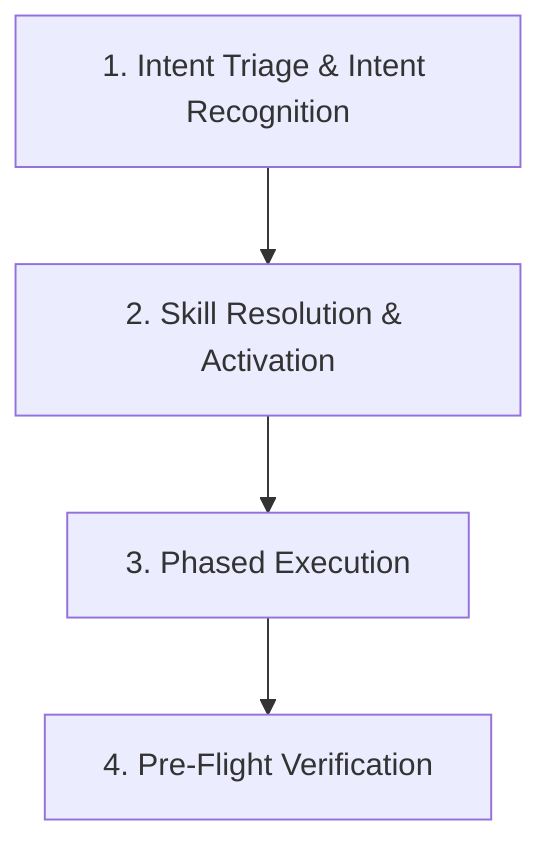

# ORCHESTRATOR: Master Meta-Agent Protocol

Dokumen ini adalah protokol utama bagi AI / Agent dalam mengelola tugas pada repositori **SeeMBG**. Setiap tugas yang diberikan pengguna harus melalui alur berpikir dan koordinasi skill yang terstandarisasi di bawah ini.

---

## 1. Prinsip Utama Orkestrasi

1. **Zero-Guessing & Strict Routing:**  
   Jangan langsung mengeksekusi kode tanpa mengetahui domain tugas. Buka [SKILL_ROUTER.md](SKILL_ROUTER.md) dan tentukan skill mana yang wajib diaktifkan.
2. **Mandatory Skill Loading:**  
   Sebelum menulis kode atau file desain, panggil `view_file` pada file `SKILL.md` dari skill yang terpilih di `.agents/skills/<nama-skill>/SKILL.md`.
3. **Anti-Slop & Premium Quality:**  
   Jika tugas berhubungan dengan UI/UX, dilarang menghasilkan desain generik/template default AI. Wajib menerapkan standar dari skill `design-taste-frontend` dan `high-end-visual-design`.
4. **Full Output Enforcement:**  
   Dilarang memotong kode dengan placeholder `// ... rest of code` atau `// TODO`. Seluruh kode harus ditulis secara lengkap dan siap pakai sesuai skill `full-output-enforcement`.

---

## 2. 4 Langkah Siklus Kerja (*Execution Lifecycle*)

### Langkah 1: Intent Triage
Menganalisis prompt pengguna untuk menentukan domain:
* Apakah ini tugas **Frontend UI**?
* Apakah ini tugas **Backend / Database / Scraping**?
* Apakah ini tugas **AI / RAG / Embedding**?
* Apakah ini tugas **Arsitektur / Dokumentasi**?

### Langkah 2: Skill Resolution & Activation
Buka [SKILL_ROUTER.md](SKILL_ROUTER.md) dan baca `SKILL.md` yang sesuai:
* Frontend Desain ➔ Aktifkan `design-taste-frontend` + `responsive-craft`.
* Kode Produksi ➔ Aktifkan `full-output-enforcement`.
* Integrasi Library Modern ➔ Aktifkan `context7-mcp`.
* Testing & Scraping ➔ Aktifkan `browser-use`.

### Langkah 3: Phased Execution
Jalankan pengerjaan secara bertahap mengikuti SOP pada [WORKFLOWS.md](WORKFLOWS.md).

### Langkah 4: Pre-Flight Verification
Sebelum mengembalikan hasil ke pengguna, pastikan:
* Kode bersih dari bug linting/TypeScript.
* Port sesuai standar SeeMBG (Frontend `2027`, Backend `2028`, AI `2029`).
* Responsif di mobile (menggunakan cascading dropdown) dan lancar di desktop.
