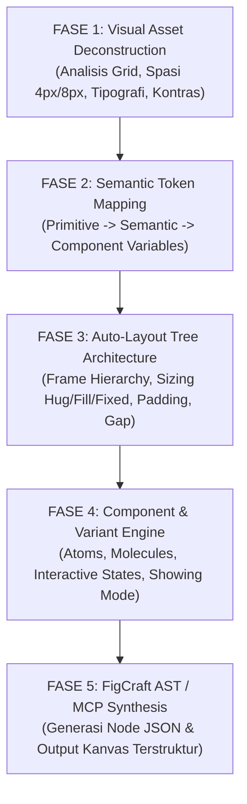
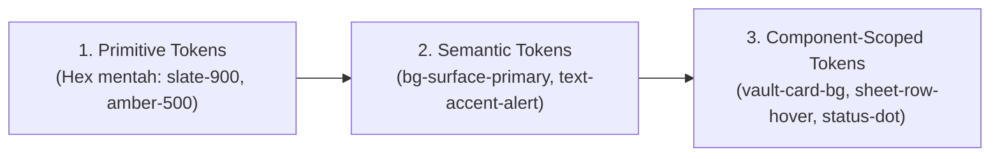

# FigCraft Designer: Master Visual Extraction & Layout Architecture Engine

Skill ini adalah protokol terlengkap dan berstandar industri untuk **merekayasa balik (*reverse-engineering*) referensi visual (gambar/screenshot/mockup)** dan **merekonstruksinya secara presisi ke dalam kanvas native FigCraft**.

FigCraft merupakan tool desain antarmuka native open-source (berbasis Rust) yang mengedepankan performa lokal, format `.figcraft` berbasis JSON/arsip, sistem Auto-Layout mutakhir, dan antarmuka kontrol terprogram melalui Model Context Protocol (MCP).

---

## 1. Siklus Kerja Ekstraksi & Desain (5-Phase Workflow)



---

## 2. Fase 1: Visual Asset Deconstruction (Reverse-Engineering)

Ketika pengguna mengirimkan screenshot referensi, jalankan audit visual dekonstruksi menggunakan 4 parameter matematis berikut:

### 2.1 Spatial Rhythm & Bounding Grid
- **Rhythm Base:** Selalu gunakan kelipatan 4px / 8px (`4, 8, 12, 16, 20, 24, 32, 40, 48, 64, 80, 96px`).
- **Canvas Viewport Targets:**
  - `Desktop Wide`: 1440px / 1920px (12-column grid, margin 48px, gutter 16px).
  - `Laptop Compact`: 1280px (12-column grid, margin 32px, gutter 16px).
  - `Tablet / Dev Split`: 768px (8-column grid).
  - `Mobile Console`: 375px / 390px (4-column grid, margin 16px, gutter 12px).
- **Hairline Borders:** Ukuran border selalu 1px solid dengan alpha blending (hindari border 2px tebal kecuali state focus aktif).

### 2.2 Color Space & Contrast Audit
Dekonstruksi warna ke dalam 3 level kedalaman:
1. **Dominant Background Layer:** Deteksi apakah true black (`#000000`), obsidian charcoal (`#080B11`), atau deep slate (`#0F172A`).
2. **Elevated Surfaces:** Hitung tingkat kontras layer di atas background (Surface 1 &rarr; Surface 2 &rarr; Hover/Active Overlay).
3. **Accent Ratio (WCAG AAA/AA):** Pastikan warna teks status (Amber `#F59E0B`, Emerald `#10B981`, Red `#EF4444`) memiliki kontras minimal 4.5:1 terhadap background.

### 2.3 Typographic Scale Matrix
Identifikasi dan kelompokkan teks gambar ke skala berikut:
| Role | Ukuran (px) | Line Height (px) | Weight | Tracking (Letter Spacing) | Family Type |
| :--- | :---: | :---: | :---: | :---: | :--- |
| **Display / Metric** | 32px - 40px | 44px - 48px | Bold (700) | -0.02em | Monospace / Sans |
| **Section Header** | 20px - 24px | 28px - 32px | SemiBold (600) | -0.015em | Sans-serif (Geist/Inter) |
| **Card / Group Title** | 14px - 16px | 20px - 24px | Medium (500) | -0.01em | Sans-serif |
| **Body Content** | 13px - 14px | 20px | Regular (400) | 0 | Sans-serif |
| **Technical / Code / Port**| 12px - 13px | 18px | Medium (500) | 0.02em (Tabular) | Monospace (`JetBrains Mono`) |
| **Badge / Caption / Micro** | 10px - 11px | 14px | SemiBold (600) | 0.04em (Uppercase) | Monospace / Sans |

---

## 3. Fase 2: FigCraft Token & Variable Architecture

Ubah hasil dekonstruksi visual menjadi struktur token FigCraft yang modular (simpan dan kelompokkan ke panel *Variables* FigCraft):



### Format Variabel FigCraft (JSON Token Export)
```json
{
  "tokens": {
    "color": {
      "bg": {
        "canvas": { "value": "#080B11", "type": "color" },
        "surface": { "value": "#0F172A", "type": "color" },
        "surface-elevated": { "value": "#1E293B", "type": "color" },
        "surface-overlay": { "value": "rgba(30, 41, 59, 0.7)", "type": "color" }
      },
      "border": {
        "subtle": { "value": "rgba(51, 65, 85, 0.4)", "type": "color" },
        "default": { "value": "#334155", "type": "color" },
        "focus": { "value": "#38BDF8", "type": "color" }
      },
      "text": {
        "primary": { "value": "#F8FAFC", "type": "color" },
        "secondary": { "value": "#94A3B8", "type": "color" },
        "muted": { "value": "#64748B", "type": "color" },
        "accent-amber": { "value": "#F59E0B", "type": "color" },
        "accent-emerald": { "value": "#10B981", "type": "color" }
      }
    },
    "spacing": {
      "xs": { "value": 4, "type": "spacing" },
      "sm": { "value": 8, "type": "spacing" },
      "md": { "value": 12, "type": "spacing" },
      "lg": { "value": 16, "type": "spacing" },
      "xl": { "value": 24, "type": "spacing" }
    },
    "radius": {
      "xs": { "value": 2, "type": "borderRadius" },
      "sm": { "value": 4, "type": "borderRadius" },
      "md": { "value": 6, "type": "borderRadius" },
      "lg": { "value": 8, "type": "borderRadius" }
    }
  }
}
```

---

## 4. Fase 3: Auto-Layout Tree Architecture (Mental Model FigCraft)

Setiap desain visual **HARUS** direpresentasikan dalam pohon Auto-Layout FigCraft yang terstruktur secara hierarkis. Dilarang meletakkan elemen *absolute positioning* tanpa alasan kuat.

### 4.1 Aturan Emas Sizing Sifat Node
* **`HUG` (Hug Contents):** Gunakan pada elemen teks, badge, tombol, dan komponen yang lebarnya menyesuaikan panjang teks di dalamnya.
* **`FILL` (Fill Container):** Gunakan pada kolom tabel, input search bar, wrapper kartu, dan list container agar mengisi seluruh ruang frame induk secara responsif.
* **`FIXED`:** Hanya gunakan pada avatar, icon frame (`16x16`, `20x20`), dan sidebar fixed width (misal `240px`).

### 4.2 Blueprint Struktur Node FigCraft

```
ROOT FRAME: "Asterisk_Dashboard_Screen" (Width: 1440, Height: 900, Layout: HORIZONTAL, Sizing: FIXED)
├── FRAME: "Global_Sidebar" (Width: 240, Height: FILL, Layout: VERTICAL, Sizing: FIXED, Padding: 16, Gap: 8)
│   ├── FRAME: "Brand_Header" (Width: FILL, Height: HUG, Layout: HORIZONTAL, Gap: 8)
│   │   ├── TEXT: "Logo_Icon" ("*", Color: Amber)
│   │   └── TEXT: "Brand_Title" ("ASTERISK", Weight: Bold)
│   └── FRAME: "Nav_List" (Width: FILL, Height: FILL, Layout: VERTICAL, Gap: 4)
│       ├── INSTANCE: "NavItem_Overview" (State: Default)
│       ├── INSTANCE: "NavItem_Vault" (State: Active)
│       └── INSTANCE: "NavItem_Sheet" (State: Default)
│
└── FRAME: "Main_Content_Area" (Width: FILL, Height: FILL, Layout: VERTICAL, Sizing: FILL)
    ├── FRAME: "Top_Navbar" (Width: FILL, Height: 56, Layout: HORIZONTAL, Padding: [0, 24], Align: SPACE_BETWEEN)
    │   ├── FRAME: "Project_Selector" (Width: HUG, Height: 36, Layout: HORIZONTAL, Gap: 8)
    │   └── FRAME: "Control_Actions" (Width: HUG, Height: 36, Layout: HORIZONTAL, Gap: 12)
    │       ├── INSTANCE: "Toggle_ShowingMode" (State: Inactive)
    │       └── INSTANCE: "User_Pill" (Name: "Rey Cannavaro", Role: "Superadmin")
    │
    └── FRAME: "Page_Viewport" (Width: FILL, Height: FILL, Layout: VERTICAL, Padding: 24, Gap: 20, Overflow: SCROLL)
        ├── FRAME: "Metrics_Row" (Width: FILL, Height: HUG, Layout: HORIZONTAL, Gap: 16)
        │   ├── INSTANCE: "Metric_Card_ActiveClients" (Width: FILL)
        │   ├── INSTANCE: "Metric_Card_ActiveGenerators" (Width: FILL)
        │   └── INSTANCE: "Metric_Card_PendingQATickets" (Width: FILL)
        └── FRAME: "Data_Section_Wrapper" (Width: FILL, Height: FILL, Layout: VERTICAL, Gap: 12)
            ├── FRAME: "Section_Toolbar" (Width: FILL, Height: HUG, Layout: HORIZONTAL, Align: SPACE_BETWEEN)
            └── FRAME: "Interactive_Grid_Frame" (Width: FILL, Height: FILL, Layout: VERTICAL, Border: 1px)
```

---

## 5. Fase 4: Component & Variant Engine (Design System)

Sebelum menyusun halaman utuh, dekonstruksi referensi ke komponen modular dengan varian status berikut:

### 5.1 Komponen: `Secret_Vault_Card`
- **Atribut:** `keyName`, `envType`, `category`, `valueMasked`, `countdownTimer`.
- **Varian Status:**
  1. `State = Masked`: Menampilkan teks `* * * * * * * *`, tombol `[👁️ Reveal]`, tombol `[📋 Copy]`.
  2. `State = Revealed`: Menampilkan teks plaintext monospaced (`font-mono`), countdown badge `[⏳ 14s]`, tombol `[🔒 Hide]`.
  3. `State = ShowingMode_Active`: Label terkunci permanen `[CONFIDENTIAL - LOCKED]`, tombol reveal di-disable.

### 5.2 Komponen: `Asterisk_Sheet_Row`
- **Atribut:** `rowNumber`, `moduleBadge`, `typeBadge`, `feedbackNote`, `statusBadge`, `actionButton`.
- **Varian Status:**
  1. `RowState = Default`: Background transparan, border bawah hairline.
  2. `RowState = Hover / Focused`: Background `#1E293B`, cell catatan memiliki border fokus biru Cyan.
  3. `RowState = Converted`: Status badge berubah hijau `[CONVERTED]`, tombol aksi menampilkan `-> Ticket #MJY-042`.

---

## 6. Fase 5: FigCraft Node JSON Schema Generation

Untuk mengekspor atau menginjeksikan struktur desain langsung ke FigCraft, gunakan skema AST Node resmi berikut:

### 6.1 Contoh AST JSON Frame Auto-Layout (FigCraft Native Format)
```json
{
  "type": "FRAME",
  "id": "node_vault_header_01",
  "name": "Vault_Header_Bar",
  "visible": true,
  "layoutMode": "HORIZONTAL",
  "primaryAxisAlignItems": "SPACE_BETWEEN",
  "counterAxisAlignItems": "CENTER",
  "paddingLeft": 16,
  "paddingRight": 16,
  "paddingTop": 12,
  "paddingBottom": 12,
  "itemSpacing": 8,
  "layoutSizingHorizontal": "FILL",
  "layoutSizingVertical": "HUG",
  "cornerRadius": 6,
  "fills": [
    {
      "type": "SOLID",
      "visible": true,
      "color": { "r": 0.0588, "g": 0.0902, "b": 0.1647, "a": 1.0 }
    }
  ],
  "strokes": [
    {
      "type": "SOLID",
      "color": { "r": 0.2, "g": 0.2549, "b": 0.3333, "a": 0.5 },
      "weight": 1.0
    }
  ],
  "children": [
    {
      "type": "TEXT",
      "id": "node_txt_title",
      "name": "Label_Title",
      "characters": "ENCRYPTED SECRETS VAULT",
      "fontSize": 13,
      "fontWeight": 600,
      "fontFamily": "Geist Sans",
      "letterSpacing": 0.05,
      "textCase": "UPPERCASE",
      "fills": [
        {
          "type": "SOLID",
          "color": { "r": 0.9725, "g": 0.9804, "b": 0.9882, "a": 1.0 }
        }
      ]
    },
    {
      "type": "FRAME",
      "id": "node_btn_reveal_all",
      "name": "Badge_Showing_Status",
      "layoutMode": "HORIZONTAL",
      "paddingLeft": 8,
      "paddingRight": 8,
      "paddingTop": 4,
      "paddingBottom": 4,
      "cornerRadius": 4,
      "fills": [
        {
          "type": "SOLID",
          "color": { "r": 0.9608, "g": 0.6196, "b": 0.0431, "a": 0.15 }
        }
      ],
      "strokes": [
        {
          "type": "SOLID",
          "color": { "r": 0.9608, "g": 0.6196, "b": 0.0431, "a": 0.4 },
          "weight": 1.0
        }
      ],
      "children": [
        {
          "type": "TEXT",
          "characters": "SHIELD ACTIVE",
          "fontSize": 11,
          "fontWeight": 700,
          "fontFamily": "JetBrains Mono",
          "fills": [
            {
              "type": "SOLID",
              "color": { "r": 0.9608, "g": 0.6196, "b": 0.0431, "a": 1.0 }
            }
          ]
        }
      ]
    }
  ]
}
```

---

## 7. Model Context Protocol (MCP) Integration Specification

Jika FigCraft dijalankan bersama server MCP lokal (`figcraft-mcp-server`), agen dapat mengeksekusi instruksi desain kanvas secara langsung melalui tool calls:

```typescript
// Contoh instruksi programmatic FigCraft MCP:
await figcraftMcp.executeBatch([
  {
    action: "createFrame",
    params: {
      name: "Asterisk_Showing_Mode_View",
      width: 1440,
      height: 900,
      layoutMode: "VERTICAL",
      fill: "#080B11"
    }
  },
  {
    action: "applyDesignTokens",
    params: {
      source: "asterisk-tokens.json"
    }
  },
  {
    action: "instantiateComponent",
    params: {
      componentName: "Vault_Table",
      targetParent: "Asterisk_Showing_Mode_View",
      properties: {
        showingMode: true
      }
    }
  }
]);
```

---

## 8. Standar Validasi Akhir (Pre-Flight Design Checklist)

Sebelum menyerahkan desain atau token kepada pengguna:
1. **Zero Free-Floating Elements:** Tidak ada elemen teks atau tombol yang melayang tanpa frame Auto-Layout (`layoutMode` harus `HORIZONTAL` atau `VERTICAL`).
2. **Tabular Numerics:** Semua angka port, IP, timestamp, dan ID tiket menggunakan font Monospace dengan fitur tabular angka aktif.
3. **Responsive Sizing Checked:** Kolom utama tabel menggunakan sizing `FILL` agar tidak terpotong saat lebar frame diubah di FigCraft.
4. **Anti-Slop Guardrail Passed:** Tidak ada gradien ungu, bayangan kartun, atau radius kartu membulat berlebihan (`>12px`).

