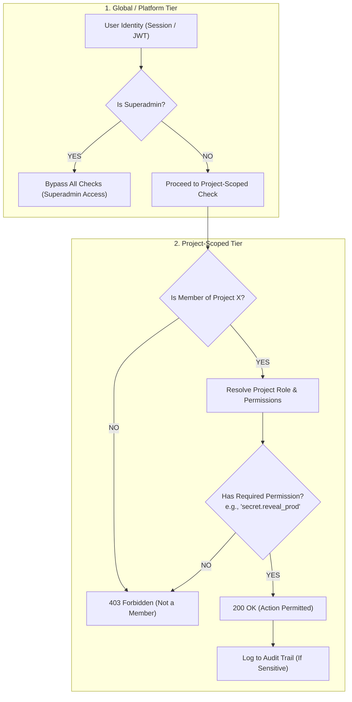
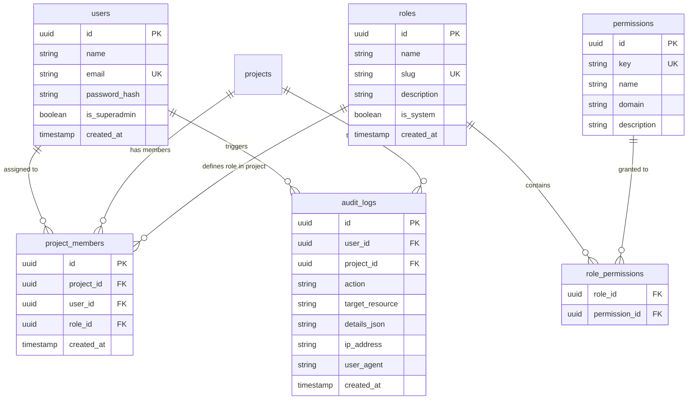

# Dynamic RBAC & Security Specification
## Project: ASTERISK (`*`)
**Dual-Tier Role-Based Access Control, Cryptographic Vault & Audit Logging Architecture**

| Metadata | Detail |
| :--- | :--- |
| **Document Version** | 1.0.0 |
| **Security Classification** | Internal Confidential |
| **Lead Architect** | Rey Cannavaro (Lead HRIS Project Manager) |
| **Backend Runtime** | ElysiaJS (Bun) |
| **Target Database** | PostgreSQL via Drizzle ORM |
| **Encryption Standard** | AES-256-GCM (Authenticated Encryption with Associated Data) |

---

## 1. Executive Security & Authorization Philosophy

Asterisk bertindak sebagai brankas pusat (*vault*) yang menyimpan konfigurasi server, port generator, dan password database untuk puluhan implementasi klien HRIS. Kebocoran satu kredensial saja dapat berakibat fatal bagi keamanan data klien.

Oleh karena itu, sistem keamanan Asterisk dirancang dengan 3 prinsip fundamental:

1. **Principle of Least Privilege (PoLP)**: Pengguna hanya diberikan hak akses minimum absolut yang mereka butuhkan untuk menyelesaikan tugas mereka.
2. **Dual-Tier Contextual Scope**: Hak akses dipisahkan antara peran global platform (*Platform Scope*) dan peran per proyek (*Project-Scoped Context*). Seorang *Lead Developer* di Klien A tidak otomatis memiliki akses ke Klien B.
3. **Zero-Trust Secret Exposure**: Password tidak pernah dikirimkan ke frontend secara *plain-text* saat memuat halaman. Pengambilan data rahasia membutuhkan *explicit on-demand reveal request* yang divalidasi ketat oleh RBAC dan **wajib dicatat ke Audit Trail**.

---

## 2. Dual-Tier Authorization Model



### 2.1 Tier 1: Platform / Global Level
- Berlaku di seluruh ekosistem Asterisk secara universal.
- **Global Roles**:
  - `SUPERADMIN` (Kamu / Lead PM): Memiliki bypass penuh (`*.*`). Berhak mengelola seluruh proyek, konfigurasi sistem, audit log, dan mendefinisikan permission dinamis.
  - `MEMBER`: Pengguna standar. Tidak memiliki akses ke project apapun sampai dimasukkan ke dalam daftar anggota project terkait (`project_members`).

### 2.2 Tier 2: Project-Scoped Level
- Setiap proyek HRIS memiliki daftar keanggotaan terisolasi.
- Pengguna yang sama dapat memiliki peran dan kewenangan yang berbeda di setiap proyek:
  - **User "Budi"** di **Project HRIS Klien A**: Berperan sebagai `Tech Lead` (bisa melihat repo, port, dan kredensial staging).
  - **User "Budi"** di **Project HRIS Klien B**: Berperan sebagai `Developer` (hanya melihat dev port dan tiket tugasnya).
  - **User "Budi"** di **Project HRIS Klien C**: Tidak terdaftar sama sekali (akses ditolak 403 Forbidden).

---

## 3. Granular Permission Taxonomy (Matriks Izin)

Permissions disusun menggunakan notasi hierarkis: `<domain>.<resource>.<action>`

| Domain | Permission Key | Deskripsi Fungsional | Level Sensitivitas |
| :--- | :--- | :--- | :--- |
| **Project** | `project.view` | Melihat detail ringkasan project & status HRIS | Rendah |
| | `project.create` | Membuat project klien HRIS baru | Tinggi (Superadmin) |
| | `project.edit` | Mengubah informasi umum project, versi HRIS, status SOW | Sedang |
| | `project.archive` | Mengarsipkan project yang sudah selesai/putus kontrak | Tinggi |
| | `project.delete` | Menghapus permanen data project | Kritis (Superadmin) |
| **Environments** | `env.view_dev` | Melihat URL, IP Host, dan Port Generator Development | Rendah |
| | `env.view_staging` | Melihat domain dan port Staging / UAT | Sedang |
| | `env.view_prod` | Melihat URL domain Production klien | Sedang |
| | `env.edit` | Memperbarui mapping port dan URL environment | Tinggi |
| **Secrets & Vault** | `secret.view_dev_masked` | Melihat daftar secret Dev (dalam keadaan tertutup `••••`) | Rendah |
| | `secret.view_prod_masked` | Melihat daftar secret Prod (dalam keadaan tertutup `••••`) | Sedang |
| | `secret.reveal_dev` | **Membuka/mengintip password database & backend Dev** | **Tinggi (Audit Log)** |
| | `secret.reveal_prod` | **Membuka/mengintip password database & backend Production** | **Kritis (Audit Log)** |
| | `secret.create` | Menambahkan credential baru ke vault | Tinggi |
| | `secret.edit` | Mengubah credential yang ada di vault | Tinggi (Audit Log) |
| | `secret.delete` | Menghapus credential dari vault | Kritis (Audit Log) |
| **Asterisk Sheet** | `sheet.view` | Membaca catatan feedback showing & support | Rendah |
| | `sheet.row_create` | Mengetik baris feedback baru saat showing berlangsung | Rendah |
| | `sheet.row_edit` | Mengubah catatan baris feedback | Rendah |
| | `sheet.row_delete` | Menghapus baris feedback dari sheet | Sedang |
| | `sheet.convert_ticket` | Mengonversi baris feedback menjadi tiket tugas resmi | Sedang |
| **Ticketing & QA** | `ticket.view` | Melihat tiket tugas dan bug tracking | Rendah |
| | `ticket.create` | Membuat tiket tugas/bug baru secara manual | Rendah |
| | `ticket.assign` | Menentukan penanggung jawab (Assignee Dev / QA) | Sedang |
| | `ticket.status_dev` | Memindahkan status dari *Backlog* &rarr; *In Progress* &rarr; *Ready for QA* | Sedang |
| | `ticket.verify_qa` | **Memvalidasi perbaikan bug (Pass/Fail) & menutup tiket (*Closed*)** | **Sedang (Khusus QA/Lead)** |
| **RBAC & Admin** | `rbac.role_manage` | Membuat dan mengubah role kustom serta permission-nya | Kritis (Superadmin) |
| | `rbac.member_assign` | Menambahkan atau menghapus anggota project dan mengatur rolenya | Tinggi |
| | `audit.view` | Membuka riwayat log audit (siapa membuka password apa) | Kritis (Superadmin) |

---

## 4. Default System Roles Matrix

Asterisk menyertakan 4 Role Bawaan Sistem (*System Roles*) yang siap digunakan, ditambah kemampuan membuat *Custom Dynamic Roles* sesuai kebutuhan.

| Permission Key | Superadmin (PM) | Tech Lead / Senior Dev | Developer | QA Engineer |
| :--- | :---: | :---: | :---: | :---: |
| `project.view` |  Yes |  Yes |  Yes |  Yes |
| `project.edit` |  Yes |  Yes | No | No |
| `env.view_dev` |  Yes |  Yes |  Yes |  Yes |
| `env.view_staging` |  Yes |  Yes |  Yes |  Yes |
| `env.view_prod` |  Yes |  Yes | No |  Yes |
| `env.edit` |  Yes |  Yes | No | No |
| `secret.view_dev_masked` |  Yes |  Yes |  Yes | No |
| `secret.reveal_dev` |  Yes (Audit) |  Yes (Audit) |  Yes (Audit) | No |
| `secret.view_prod_masked` |  Yes |  Yes | No | No |
| `secret.reveal_prod` |  Yes (Audit) |  Yes (Audit) | No | No |
| `secret.create` / `edit` |  Yes (Audit) |  Yes (Audit) | No | No |
| `sheet.view` |  Yes |  Yes |  Yes |  Yes |
| `sheet.row_create` / `edit` |  Yes |  Yes |  Yes |  Yes |
| `sheet.convert_ticket` |  Yes |  Yes | No |  Yes |
| `ticket.create` / `view` |  Yes |  Yes |  Yes |  Yes |
| `ticket.status_dev` |  Yes |  Yes |  Yes | No |
| `ticket.verify_qa` |  Yes |  Yes | No |  Yes |
| `rbac.role_manage` |  Yes | No | No | No |
| `rbac.member_assign` |  Yes |  Yes | No | No |
| `audit.view` |  Yes | No | No | No |

---

## 5. Dynamic Role Engine & Data Modeling

Untuk mewujudkan RBAC yang dinamis (bisa membuat role kustom baru di UI tanpa mengubah kode program), struktur data menggunakan skema normalisasi berikut:



---

## 6. Cryptographic Vault Specification (Secrets Security)

### 6.1 Algoritma Enkripsi Data
Seluruh nilai rahasia (password database backend, generator access token, private key SSH) **WAJIB** dienkripsi sebelum disimpan ke dalam kolom database `ciphertext`.

- **Spesifikasi**: **AES-256-GCM (Galois/Counter Mode)**.
  - Panjang Kunci (*Key Length*): 256-bit (32 bytes).
  - Initialization Vector (IV / Nonce): 96-bit (12 bytes) acak, dihasilkan menggunakan generator kriptografi acak (*CSPRNG*) untuk setiap operasi enkripsi.
  - Authentication Tag: 128-bit (16 bytes) untuk mendeteksi adanya manipulasi atau korupsi data (*Integrity & Authenticity Check*).

### 6.2 Format Penyimpanan Ciphertext
Di tabel database `project_secrets`, nilai rahasia disimpan dalam format gabungan string berkarakter pembatas (*colon-separated base64*):
```
$enc$gcm$v1$<iv_base64>$<ciphertext_base64>$<tag_base64>
```

### 6.3 Pengelolaan Master Key (Key Management)
- Master Key 256-bit di-generate satu kali dan disuntikkan ke backend Elysia via Environment Variable server EC2:
  ```env
  ASTERISK_MASTER_ENCRYPTION_KEY=64_char_hex_or_base64_string_here
  ```
- **Aturan Mutlak**: Master key dilarang keras (*STRICTLY FORBIDDEN*) di-*hardcode* di dalam kode TypeScript atau di-commit ke Git repository.

---

## 7. Audit Trail Specification (Zero-Trust Traceability)

Karena sistem memberikan fitur untuk membuka password mentah (*reveal password*), mekanisme pertanggungjawaban mutlak diperlukan untuk mencegah penyalahgunaan wewenang.

### 7.1 Daftar Aksi yang Wajib Dicatat (*Audited Actions*)

| Event Code | Kategori | Kondisi Pemicu | Data Tambahan yang Disimpan (`details_json`) |
| :--- | :--- | :--- | :--- |
| `SECRET_REVEALED` | Keamanan Kritis | User menekan tombol `Reveal` pada secret tertentu | `{"secret_id": "...", "secret_key_name": "DB_PASSWORD", "env": "PROD"}` |
| `SECRET_CREATED` | Keamanan | Menambahkan item secret baru ke vault | `{"secret_key_name": "BACKEND_JWT_KEY", "env": "DEV"}` |
| `SECRET_UPDATED` | Keamanan | Mengubah nilai atau nama secret | `{"secret_id": "...", "action": "value_changed"}` |
| `SECRET_DELETED` | Keamanan | Menghapus secret dari vault | `{"secret_id": "...", "deleted_name": "..."}` |
| `MEMBER_ASSIGNED` | RBAC | Menambahkan anggota baru ke project | `{"target_user_id": "...", "role_assigned": "Tech Lead"}` |
| `ROLE_UPDATED` | RBAC Dinamis | Mengubah matriks permission pada suatu role | `{"role_id": "...", "permissions_added": [...], "permissions_removed": [...]}` |
| `SHOWING_MODE_TOGGLED` | Privasi | Mengaktifkan atau menonaktifkan Showing Mode | `{"new_state": "ACTIVE"}` |

### 7.2 Aturan Immutability (Anti-Tampering)
- Tabel `audit_logs` bertipe **Append-Only**.
- Elysia backend **TIDAK MENYEDIAKAN** endpoint API untuk operasi `UPDATE` maupun `DELETE` pada tabel audit log.
- Hak akses database untuk user Asterisk di PostgreSQL tidak diberikan izin `TRUNCATE` atau `DELETE` pada tabel `audit_logs`.

---

## 8. Pola Implementasi pada ElysiaJS Backend

ElysiaJS memiliki fitur plugin dan *derive / guard context* yang sangat ideal untuk menjalankan evaluasi RBAC secara efisien:

### 8.1 Evaluasi Permission Guard Pattern (Elysia Pattern)
```typescript
// Contoh arsitektur guard di ElysiaJS:
import { Elysia, t } from 'elysia'

export const rbacGuard = (requiredPermission: string) => 
  new Elysia({ name: `rbac-${requiredPermission}` })
    .derive(async ({ request, headers, set, authService, rbacService }) => {
      // 1. Ekstrak User dari Session / JWT
      const user = await authService.getUserFromSession(headers)
      if (!user) {
        set.status = 401
        throw new Error('UNAUTHORIZED')
      }

      // 2. Jika Superadmin, bypass evaluasi
      if (user.isSuperadmin) {
        return { user }
      }

      // 3. Ambil project_id dari header atau parameter URL
      const projectId = headers['x-project-id'] || null
      if (!projectId) {
        set.status = 400
        throw new Error('PROJECT_CONTEXT_REQUIRED')
      }

      // 4. Evaluasi izin spesifik pada project tersebut
      const isAllowed = await rbacService.hasPermission({
        userId: user.id,
        projectId,
        permissionKey: requiredPermission
      })

      if (!isAllowed) {
        set.status = 403
        throw new Error(`FORBIDDEN_INSUFFICIENT_PERMISSION: ${requiredPermission}`)
      }

      return { user, projectId }
    })
```

### 8.2 Proteksi Endpoint Reveal Secret
```typescript
// Endpoint khusus reveal secret dengan audit logging otomatis
app.post('/api/projects/:projectId/secrets/:secretId/reveal', async ({ params, user, auditService, vaultService, ip, headers }) => {
  // 1. Dekripsi password dari vault
  const decryptedValue = await vaultService.revealSecret(params.secretId)

  // 2. Wajib: Tulis ke Audit Log sebelum mengirimkan data
  await auditService.log({
    userId: user.id,
    projectId: params.projectId,
    action: 'SECRET_REVEALED',
    targetResource: `secret:${params.secretId}`,
    ipAddress: ip,
    userAgent: headers['user-agent'] || 'unknown',
    details: { env: decryptedValue.envType, keyName: decryptedValue.keyName }
  })

  // 3. Return plaintext hanya ke client yang berhak
  return {
    success: true,
    data: {
      value: decryptedValue.plainText
    }
  }
}, {
  // Guard memastikan caller memiliki izin spesifik
  // secret.reveal_dev atau secret.reveal_prod tergantung environment
})
```

---

## 9. Next Steps
Dengan tuntasnya dokumen spesifikasi RBAC dan Keamanan ini:
1. Kita memiliki panduan pasti untuk merancang skema database PostgreSQL di Drizzle ORM: **[Database Architecture & ERD](file:///c:/Users/Rey%20Cannavaro/asterisk/docs/03-Database-Design-and-ERD.md)**.
2. Seluruh tabel otentikasi, perizinan, vault terenkripsi, dan audit log memiliki keterikatan relasional yang jelas.

