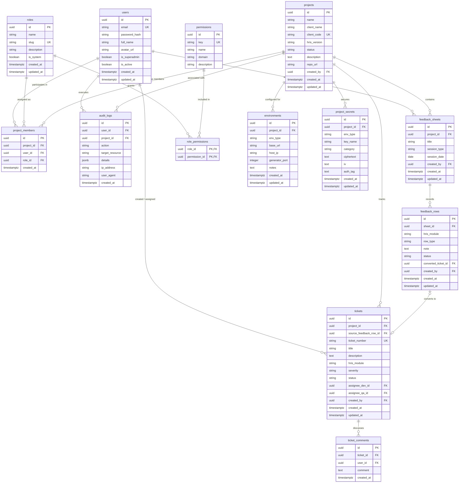

# Database Design & Entity Relationship Diagram (ERD)
## Project: ASTERISK (`*`)
**PostgreSQL Relational Schema & Drizzle ORM Specification**

| Metadata | Detail |
| :--- | :--- |
| **Document Version** | 1.0.0 |
| **Target Database Engine** | PostgreSQL 16+ |
| **Object-Relational Mapping (ORM)** | Drizzle ORM (TypeScript) |
| **Primary Key Standard** | UUID v4 (Cryptographically random) |
| **Timestamp Standard** | UTC (`TIMESTAMPTZ`) |

---

## 1. Visual Entity Relationship Diagram (ERD)



---

## 2. Kamus Data Rinci (Data Dictionary)

### 2.1 Kluster Otentikasi & Dynamic RBAC

#### 1. Tabel: `users`
Menyimpan identitas seluruh anggota tim Asterisk.
| Kolom | Tipe Data | Constraint | Keterangan |
| :--- | :--- | :--- | :--- |
| `id` | `UUID` | PK, Default `gen_random_uuid()` | Pengenal unik user |
| `email` | `VARCHAR(255)` | NOT NULL, UNIQUE | Email login resmi kantor |
| `password_hash` | `TEXT` | NOT NULL | Hash password (Argon2id / bcrypt) |
| `full_name` | `VARCHAR(150)` | NOT NULL | Nama lengkap anggota tim |
| `avatar_url` | `TEXT` | NULL | URL foto profil pengguna |
| `is_superadmin` | `BOOLEAN` | NOT NULL, Default `FALSE` | Flag bypass untuk Lead PM (Rey) |
| `is_active` | `BOOLEAN` | NOT NULL, Default `TRUE` | Status aktif akun (bisa dinonaktifkan) |
| `created_at` | `TIMESTAMPTZ` | NOT NULL, Default `NOW()` | Waktu pembuatan akun |
| `updated_at` | `TIMESTAMPTZ` | NOT NULL, Default `NOW()` | Waktu pembaruan profil |

#### 2. Tabel: `roles`
Menyimpan definisi role bawaan (*system*) maupun role kustom yang dibuat dinamis.
| Kolom | Tipe Data | Constraint | Keterangan |
| :--- | :--- | :--- | :--- |
| `id` | `UUID` | PK, Default `gen_random_uuid()` | ID role |
| `name` | `VARCHAR(100)` | NOT NULL | Nama role (misal: "Tech Lead", "QA Tester") |
| `slug` | `VARCHAR(100)` | NOT NULL, UNIQUE | Identifier unik slug (misal: `tech-lead`) |
| `description` | `TEXT` | NULL | Penjelasan tanggung jawab role |
| `is_system` | `BOOLEAN` | NOT NULL, Default `FALSE` | Jika `TRUE`, tidak boleh dihapus via UI |
| `created_at` | `TIMESTAMPTZ` | NOT NULL, Default `NOW()` | Waktu dibuat |
| `updated_at` | `TIMESTAMPTZ` | NOT NULL, Default `NOW()` | Waktu diupdate |

#### 3. Tabel: `permissions`
Master seluruh kapabilitas izin dalam sistem Asterisk.
| Kolom | Tipe Data | Constraint | Keterangan |
| :--- | :--- | :--- | :--- |
| `id` | `UUID` | PK, Default `gen_random_uuid()` | ID permission |
| `key` | `VARCHAR(100)` | NOT NULL, UNIQUE | Kunci permission (misal: `secret.reveal_prod`) |
| `name` | `VARCHAR(150)` | NOT NULL | Nama ramah pengguna |
| `domain` | `VARCHAR(50)` | NOT NULL | Pengelompokan (`PROJECT`, `VAULT`, `SHEET`, `TICKET`, `RBAC`) |
| `description` | `TEXT` | NULL | Penjelasan detail efek izin |

#### 4. Tabel: `role_permissions` (Pivot Table)
Memetakan hak akses apa saja yang dimiliki oleh suatu role.
| Kolom | Tipe Data | Constraint | Keterangan |
| :--- | :--- | :--- | :--- |
| `role_id` | `UUID` | FK `roles.id` ON DELETE CASCADE | ID role terkait |
| `permission_id` | `UUID` | FK `permissions.id` ON DELETE CASCADE | ID permission terkait |
*Primary Key gabungan:* `(role_id, permission_id)`.

#### 5. Tabel: `project_members` (Project-Scoped Access)
Mengatur keanggotaan dan peran spesifik user pada proyek tertentu.
| Kolom | Tipe Data | Constraint | Keterangan |
| :--- | :--- | :--- | :--- |
| `id` | `UUID` | PK, Default `gen_random_uuid()` | ID keanggotaan |
| `project_id` | `UUID` | FK `projects.id` ON DELETE CASCADE | Proyek tujuan |
| `user_id` | `UUID` | FK `users.id` ON DELETE CASCADE | Pengguna yang ditugaskan |
| `role_id` | `UUID` | FK `roles.id` ON DELETE RESTRICT | Role pengguna di proyek ini |
| `created_at` | `TIMESTAMPTZ` | NOT NULL, Default `NOW()` | Tanggal penugasan |
*Unique Constraint:* `UNIQUE(project_id, user_id)`.

---

### 2.2 Kluster Proyek & Brankas Kredensial (Vault)

#### 6. Tabel: `projects`
Katalog induk seluruh klien HRIS.
| Kolom | Tipe Data | Constraint | Keterangan |
| :--- | :--- | :--- | :--- |
| `id` | `UUID` | PK, Default `gen_random_uuid()` | ID proyek |
| `name` | `VARCHAR(200)` | NOT NULL | Nama sistem (misal: "HRIS PT Maju Jaya") |
| `client_name` | `VARCHAR(200)` | NOT NULL | Nama resmi klien / perusahaan |
| `client_code` | `VARCHAR(20)` | NOT NULL, UNIQUE | Kode singkatan unik (misal: `MJY`, `TELK`) |
| `hris_version` | `VARCHAR(50)` | NOT NULL | Versi HRIS (misal: `v3.2.0-multi-tenant`) |
| `status` | `VARCHAR(30)` | NOT NULL, Default `'IN_PROGRESS'` | `IN_PROGRESS`, `UAT`, `LIVE`, `MAINTENANCE` |
| `description` | `TEXT` | NULL | Catatan lingkup SOW proyek |
| `repo_url` | `TEXT` | NULL | Tautan GitHub / GitLab workspace |
| `created_by` | `UUID` | FK `users.id` ON DELETE SET NULL | PM pembuat record |
| `created_at` | `TIMESTAMPTZ` | NOT NULL, Default `NOW()` | Tanggal pembuatan |
| `updated_at` | `TIMESTAMPTZ` | NOT NULL, Default `NOW()` | Tanggal pembaruan |

#### 7. Tabel: `environments`
Menyimpan port generator, IP server, dan URL endpoint.
| Kolom | Tipe Data | Constraint | Keterangan |
| :--- | :--- | :--- | :--- |
| `id` | `UUID` | PK, Default `gen_random_uuid()` | ID environment |
| `project_id` | `UUID` | FK `projects.id` ON DELETE CASCADE | Terhubung ke project |
| `env_type` | `VARCHAR(20)` | NOT NULL | `DEV`, `STAGING`, `PRODUCTION` |
| `base_url` | `TEXT` | NULL | URL aplikasi / frontend |
| `host_ip` | `VARCHAR(50)` | NULL | Alamat IP Host / VPS / VM |
| `generator_port` | `INTEGER` | NULL | Port running service generator HRIS |
| `notes` | `TEXT` | NULL | Catatan teknis (misal: cara restart service) |
| `created_at` | `TIMESTAMPTZ` | NOT NULL, Default `NOW()` | Waktu dibuat |
| `updated_at` | `TIMESTAMPTZ` | NOT NULL, Default `NOW()` | Waktu diupdate |
*Unique Constraint:* `UNIQUE(project_id, env_type)`.

#### 8. Tabel: `project_secrets` (The Encrypted Vault)
Tempat penyimpanan kredensial terenkripsi (AES-256-GCM).
| Kolom | Tipe Data | Constraint | Keterangan |
| :--- | :--- | :--- | :--- |
| `id` | `UUID` | PK, Default `gen_random_uuid()` | ID rahasia |
| `project_id` | `UUID` | FK `projects.id` ON DELETE CASCADE | Terhubung ke project |
| `env_type` | `VARCHAR(20)` | NOT NULL | `DEV`, `STAGING`, `PRODUCTION` |
| `key_name` | `VARCHAR(100)` | NOT NULL | Nama variabel (misal: `DB_PASSWORD`, `API_KEY`) |
| `category` | `VARCHAR(50)` | NOT NULL, Default `'DATABASE'` | `DATABASE`, `BACKEND_AUTH`, `SERVER_SSH` |
| `ciphertext` | `TEXT` | NOT NULL | Nilai terenkripsi (Base64) |
| `iv` | `TEXT` | NOT NULL | Nonce/IV acak 12-byte (Base64) |
| `auth_tag` | `TEXT` | NOT NULL | Tag otentikasi GCM 16-byte (Base64) |
| `created_at` | `TIMESTAMPTZ` | NOT NULL, Default `NOW()` | Waktu disimpan |
| `updated_at` | `TIMESTAMPTZ` | NOT NULL, Default `NOW()` | Waktu diperbarui |

---

### 2.3 Kluster Asterisk Sheet & Feedback Logger

#### 9. Tabel: `feedback_sheets`
Wadah sesi pertemuan / showing / support log.
| Kolom | Tipe Data | Constraint | Keterangan |
| :--- | :--- | :--- | :--- |
| `id` | `UUID` | PK, Default `gen_random_uuid()` | ID sesi sheet |
| `project_id` | `UUID` | FK `projects.id` ON DELETE CASCADE | Terhubung ke project |
| `title` | `VARCHAR(200)` | NOT NULL | Misal: "Showing Modul Payroll Sprint 3" |
| `session_type` | `VARCHAR(50)` | NOT NULL, Default `'SHOWING'` | `SHOWING`, `CLIENT_SUPPORT`, `INTERNAL_QA` |
| `session_date` | `DATE` | NOT NULL, Default `CURRENT_DATE` | Tanggal meeting / showing |
| `created_by` | `UUID` | FK `users.id` ON DELETE SET NULL | Notulis / PM yang membuka sesi |
| `created_at` | `TIMESTAMPTZ` | NOT NULL, Default `NOW()` | Waktu dibuat |
| `updated_at` | `TIMESTAMPTZ` | NOT NULL, Default `NOW()` | Waktu diupdate |

#### 10. Tabel: `feedback_rows`
Baris entri cepat bergaya spreadsheet/Notion table.
| Kolom | Tipe Data | Constraint | Keterangan |
| :--- | :--- | :--- | :--- |
| `id` | `UUID` | PK, Default `gen_random_uuid()` | ID baris entri |
| `sheet_id` | `UUID` | FK `feedback_sheets.id` ON DELETE CASCADE | Terhubung ke sesi sheet |
| `hris_module` | `VARCHAR(100)` | NOT NULL | Misal: `PAYROLL`, `ATTENDANCE`, `OVERTIME` |
| `row_type` | `VARCHAR(50)` | NOT NULL, Default `'FEEDBACK'` | `FEEDBACK`, `BUG`, `QUESTION`, `CHANGE_REQUEST` |
| `note` | `TEXT` | NOT NULL | Catatan yang diketik cepat saat meeting |
| `status` | `VARCHAR(30)` | NOT NULL, Default `'OPEN'` | `OPEN`, `CONVERTED_TO_TICKET`, `RESOLVED` |
| `converted_ticket_id` | `UUID` | FK `tickets.id` ON DELETE SET NULL, NULLABLE | ID tiket hasil konversi (jika ada) |
| `created_by` | `UUID` | FK `users.id` ON DELETE SET NULL | User pembuat entri |
| `created_at` | `TIMESTAMPTZ` | NOT NULL, Default `NOW()` | Waktu diinput |
| `updated_at` | `TIMESTAMPTZ` | NOT NULL, Default `NOW()` | Waktu diedit |

---

### 2.4 Kluster Ticketing & QA Workflow

#### 11. Tabel: `tickets`
Pelacakan pekerjaan developer dan verifikasi QA.
| Kolom | Tipe Data | Constraint | Keterangan |
| :--- | :--- | :--- | :--- |
| `id` | `UUID` | PK, Default `gen_random_uuid()` | ID tiket |
| `project_id` | `UUID` | FK `projects.id` ON DELETE CASCADE | Proyek terkait |
| `source_feedback_row_id`| `UUID` | FK `feedback_rows.id` ON DELETE SET NULL | Baris asal feedback (jika dari sheet) |
| `ticket_number` | `VARCHAR(50)` | NOT NULL, UNIQUE | Kode human-readable (misal: `MJY-042`) |
| `title` | `VARCHAR(255)` | NOT NULL | Judul ringkas pekerjaan / bug |
| `description` | `TEXT` | NULL | Penjelasan detail atau langkah reproduksi |
| `hris_module` | `VARCHAR(100)` | NOT NULL | Modul HRIS yang terdampak |
| `severity` | `VARCHAR(30)` | NOT NULL, Default `'MEDIUM'` | `TRIVIAL`, `LOW`, `MEDIUM`, `HIGH`, `BLOCKER` |
| `status` | `VARCHAR(30)` | NOT NULL, Default `'BACKLOG'` | `BACKLOG`, `IN_PROGRESS`, `READY_FOR_QA`, `VERIFIED_CLOSED` |
| `assignee_dev_id` | `UUID` | FK `users.id` ON DELETE SET NULL | Developer yang mengerjakan |
| `assignee_qa_id` | `UUID` | FK `users.id` ON DELETE SET NULL | QA yang memverifikasi |
| `created_by` | `UUID` | FK `users.id` ON DELETE SET NULL | Pembuat tiket |
| `created_at` | `TIMESTAMPTZ` | NOT NULL, Default `NOW()` | Waktu dibuat |
| `updated_at` | `TIMESTAMPTZ` | NOT NULL, Default `NOW()` | Waktu update |

#### 12. Tabel: `ticket_comments`
Ruang diskusi antara Dev dan QA mengenai bug/tiket tersebut.
| Kolom | Tipe Data | Constraint | Keterangan |
| :--- | :--- | :--- | :--- |
| `id` | `UUID` | PK, Default `gen_random_uuid()` | ID komentar |
| `ticket_id` | `UUID` | FK `tickets.id` ON DELETE CASCADE | Tiket yang dikomentari |
| `user_id` | `UUID` | FK `users.id` ON DELETE SET NULL | Penulis komentar |
| `comment` | `TEXT` | NOT NULL | Isi teks komentar / hasil testing QA |
| `created_at` | `TIMESTAMPTZ` | NOT NULL, Default `NOW()` | Waktu kirim |

---

### 2.5 Kluster Audit Trail

#### 13. Tabel: `audit_logs` (Append-Only)
| Kolom | Tipe Data | Constraint | Keterangan |
| :--- | :--- | :--- | :--- |
| `id` | `UUID` | PK, Default `gen_random_uuid()` | ID log |
| `user_id` | `UUID` | FK `users.id` ON DELETE SET NULL | Pelaku aksi |
| `project_id` | `UUID` | FK `projects.id` ON DELETE SET NULL | Proyek yang diakses (jika relevan) |
| `action` | `VARCHAR(100)` | NOT NULL | `SECRET_REVEALED`, `MEMBER_ASSIGNED`, dll. |
| `target_resource` | `VARCHAR(150)` | NOT NULL | Misal: `secret:uuid-123` atau `project:uuid-456` |
| `details` | `JSONB` | NULL | Detail konteks aksi (metadata variabel) |
| `ip_address` | `VARCHAR(45)` | NULL | Alamat IPv4 atau IPv6 pemanggil |
| `user_agent` | `TEXT` | NULL | Browser / Client User-Agent |
| `created_at` | `TIMESTAMPTZ` | NOT NULL, Default `NOW()` | Waktu eksekusi aksi |

---

## 3. Strategi Indexing (Performance Optimization)

Untuk memastikan query backend Elysia tetap berada di bawah **50 ms** bahkan ketika ratusan tiket dan entri feedback tersimpan:

```sql
-- 1. Indexing untuk pengecekan cepat RBAC di setiap request
CREATE INDEX idx_project_members_lookup ON project_members(project_id, user_id);
CREATE INDEX idx_role_permissions_lookup ON role_permissions(role_id, permission_id);

-- 2. Indexing untuk pengambilan data Vault terisolasi per environment
CREATE INDEX idx_project_secrets_env ON project_secrets(project_id, env_type);
CREATE INDEX idx_environments_lookup ON environments(project_id, env_type);

-- 3. Indexing untuk kecepatan pencarian tiket dan sheet per modul
CREATE INDEX idx_tickets_project_status ON tickets(project_id, status);
CREATE INDEX idx_feedback_rows_sheet ON feedback_rows(sheet_id, status);

-- 4. Indexing untuk pelacakan log audit berurutan waktu
CREATE INDEX idx_audit_logs_timestamp ON audit_logs(created_at DESC);
CREATE INDEX idx_audit_logs_project_user ON audit_logs(project_id, user_id);
```

---

## 4. Drizzle ORM Schema Snippet (TypeScript Reference)

Contoh struktur definisi tabel menggunakan Drizzle ORM di Bun/TypeScript:

```typescript
import { pgTable, uuid, varchar, text, boolean, timestamp, jsonb, integer, date } from 'drizzle-orm/pg-core';
import { relations } from 'drizzle-orm';

// --- USERS TABLE ---
export const users = pgTable('users', {
  id: uuid('id').defaultRandom().primaryKey(),
  email: varchar('email', { length: 255 }).notNull().unique(),
  passwordHash: text('password_hash').notNull(),
  fullName: varchar('full_name', { length: 150 }).notNull(),
  avatarUrl: text('avatar_url'),
  isSuperadmin: boolean('is_superadmin').default(false).notNull(),
  isActive: boolean('is_active').default(true).notNull(),
  createdAt: timestamp('created_at', { withTimezone: true }).defaultNow().notNull(),
  updatedAt: timestamp('updated_at', { withTimezone: true }).defaultNow().notNull(),
});

// --- SECRETS VAULT TABLE ---
export const projectSecrets = pgTable('project_secrets', {
  id: uuid('id').defaultRandom().primaryKey(),
  projectId: uuid('project_id').references(() => projects.id, { onDelete: 'cascade' }).notNull(),
  envType: varchar('env_type', { length: 20 }).notNull(), // 'DEV' | 'STAGING' | 'PRODUCTION'
  keyName: varchar('key_name', { length: 100 }).notNull(),
  category: varchar('category', { length: 50 }).default('DATABASE').notNull(),
  ciphertext: text('ciphertext').notNull(),
  iv: text('iv').notNull(),
  authTag: text('auth_tag').notNull(),
  createdAt: timestamp('created_at', { withTimezone: true }).defaultNow().notNull(),
  updatedAt: timestamp('updated_at', { withTimezone: true }).defaultNow().notNull(),
});

// --- FEEDBACK ROWS (ASTERISK SHEET) ---
export const feedbackRows = pgTable('feedback_rows', {
  id: uuid('id').defaultRandom().primaryKey(),
  sheetId: uuid('sheet_id').references(() => feedbackSheets.id, { onDelete: 'cascade' }).notNull(),
  hrisModule: varchar('hris_module', { length: 100 }).notNull(),
  rowType: varchar('row_type', { length: 50 }).default('FEEDBACK').notNull(),
  note: text('note').notNull(),
  status: varchar('status', { length: 30 }).default('OPEN').notNull(),
  convertedTicketId: uuid('converted_ticket_id').references(() => tickets.id, { onDelete: 'set null' }),
  createdBy: uuid('created_by').references(() => users.id, { onDelete: 'set null' }),
  createdAt: timestamp('created_at', { withTimezone: true }).defaultNow().notNull(),
  updatedAt: timestamp('updated_at', { withTimezone: true }).defaultNow().notNull(),
});
```

---

## 5. Next Steps
Dengan tersedianya skema database dan ERD lengkap ini:
1. Kita memiliki spesifikasi presisi untuk dokumen ke-4: **[Technical Architecture & EC2 Topology Blueprint](file:///c:/Users/Rey%20Cannavaro/asterisk/docs/04-Architecture-and-Deployment.md)**.
2. Kita siap melakukan *scaffolding* project (inisialisasi backend Elysia dengan Drizzle ORM dan PostgreSQL Docker container).

