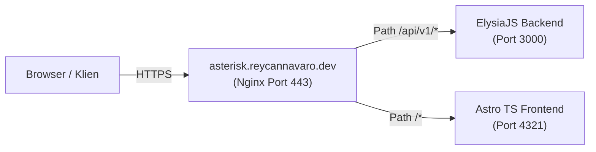

# API Contract & Eden Schema (Interface Definition)
## Project: ASTERISK (`*`)
**ElysiaJS TypeBox Endpoints, Eden Treaty Type-Safety, & Domain Routing Specification**

| Metadata | Detail |
| :--- | :--- |
| **Document Version** | 1.0.0 |
| **Base Domain** | `https://asterisk.reycannavaro.dev` |
| **API Base URL** | `https://asterisk.reycannavaro.dev/api/v1` |
| **Backend Engine** | ElysiaJS (Bun) with `@elysiajs/swagger` & TypeBox |
| **Frontend Client** | Eden Treaty (`@elysiajs/eden`) on Astro TS |
| **Authentication Scheme** | HTTP-Only Secure Cookie (`asterisk_session`) |

---

## 1. Domain & Routing Architecture

Sesuai domain yang kamu miliki (`reycannavaro.dev`), konfigurasi routing publik dipusatkan pada satu subdomain terpadu melalui Nginx Reverse Proxy:



- **Frontend Portal**: `https://asterisk.reycannavaro.dev/`
- **REST & Swagger UI**: `https://asterisk.reycannavaro.dev/api/v1/swagger`
- **Core API Endpoints**: `https://asterisk.reycannavaro.dev/api/v1/*`

---

## 2. Standard Response & Error Envelope

Setiap endpoint Elysia **WAJIB** mengembalikan format JSON yang konsisten agar mudah divalidasi oleh Eden Treaty di frontend Astro:

### 2.1 Respon Sukses (HTTP 200 / 201)
```typescript
interface ApiResponseSuccess<T> {
  success: true;
  data: T;
  meta?: {
    total?: number;
    page?: number;
    limit?: number;
    timestamp: string;
  };
}
```

### 2.2 Respon Error (HTTP 4xx / 5xx)
```typescript
interface ApiResponseError {
  success: false;
  error: {
    code: string;       // Misal: 'FORBIDDEN_PROD_ACCESS', 'SECRET_NOT_FOUND'
    message: string;    // Pesan ramah pengguna
    details?: unknown;  // Detail validasi TypeBox / Stack Trace (khusus Dev)
    timestamp: string;
  };
}
```

---

## 3. Eden Treaty: End-to-End Type Safety di Astro

Dengan **Eden Treaty**, kita tidak perlu lagi mendefinisikan interface TypeScript manual di frontend. Astro langsung mengonsumsi tipe schema dari Elysia:

```typescript
// frontend/src/lib/eden.ts
import { treaty } from '@elysiajs/eden';
import type { App } from '../../../backend/src/index';

// Client Eden yang 100% Type-Safe dan Auto-Complete
export const api = treaty<App>('asterisk.reycannavaro.dev/api/v1', {
  fetcher: fetch,
  onRequest: (path, options) => {
    // Otomatis menyertakan credentials / cookie
    options.credentials = 'include';
  }
});

// Contoh pemakaian di komponen Astro / React:
// const { data, error } = await api.projects({ id: '123' }).get();
// data.name -> Otomatis autocomplete & type-safe!
```

---

## 4. API Endpoints Breakdown & Schemas

### 4.1 Modul 1: Authentication (`/auth`)

| Method | Endpoint | Deskripsi | Auth / Role |
| :--- | :--- | :--- | :--- |
| `POST` | `/auth/login` | Login dengan email & password | Publik |
| `POST` | `/auth/logout` | Hapus session cookie | Authenticated |
| `GET` | `/auth/me` | Ambil profil user yang sedang login + global roles | Authenticated |

#### Schema Definition:
```typescript
// POST /auth/login
export const LoginSchema = {
  body: t.Object({
    email: t.String({ format: 'email' }),
    password: t.String({ minLength: 8 })
  }),
  response: {
    200: t.Object({
      success: t.Boolean(),
      data: t.Object({
        user: t.Object({
          id: t.String({ format: 'uuid' }),
          email: t.String(),
          fullName: t.String(),
          isSuperadmin: t.Boolean()
        })
      })
    })
  }
};
```

---

### 4.2 Modul 2: Dynamic RBAC & Project Membership (`/rbac`)

| Method | Endpoint | Deskripsi | Permission Key |
| :--- | :--- | :--- | :--- |
| `GET` | `/rbac/roles` | Daftar seluruh role (system & custom) | `rbac.role_manage` |
| `POST` | `/rbac/roles` | Membuat custom role baru | `rbac.role_manage` |
| `PUT` | `/rbac/roles/:roleId` | Mengubah permission pada custom role | `rbac.role_manage` |
| `GET` | `/rbac/permissions` | Daftar seluruh permission key yang ada | `rbac.role_manage` |
| `GET` | `/projects/:projectId/members` | Daftar anggota di project tersebut | `project.view` |
| `POST` | `/projects/:projectId/members` | Menugaskan user ke project dengan role tertentu | `rbac.member_assign` |
| `DELETE`| `/projects/:projectId/members/:memberId`| Menghapus anggota dari project | `rbac.member_assign` |

#### Schema Definition:
```typescript
// POST /rbac/roles
export const CreateRoleSchema = {
  body: t.Object({
    name: t.String({ minLength: 3 }),
    slug: t.String({ minLength: 3 }),
    description: t.Optional(t.String()),
    permissionIds: t.Array(t.String({ format: 'uuid' }))
  })
};

// POST /projects/:projectId/members
export const AssignMemberSchema = {
  body: t.Object({
    userId: t.String({ format: 'uuid' }),
    roleId: t.String({ format: 'uuid' })
  })
};
```

---

### 4.3 Modul 3: Projects & Environments (`/projects`)

| Method | Endpoint | Deskripsi | Permission Key |
| :--- | :--- | :--- | :--- |
| `GET` | `/projects` | Mengambil seluruh project yang diizinkan untuk user | `project.view` |
| `POST` | `/projects` | Membuat project klien HRIS baru | `project.create` |
| `GET` | `/projects/:projectId` | Detail informasi project klien | `project.view` |
| `PUT` | `/projects/:projectId` | Mengubah informasi project (versi HRIS, SOW) | `project.edit` |
| `GET` | `/projects/:projectId/environments` | Mengambil daftar port generator, IP, dan URL | `env.view_dev` / `env.view_prod` |
| `PUT` | `/projects/:projectId/environments/:envType`| Mengupdate konfigurasi port/host environment | `env.edit` |

#### Schema Definition:
```typescript
// POST /projects
export const CreateProjectSchema = {
  body: t.Object({
    name: t.String({ minLength: 3 }),
    clientName: t.String({ minLength: 2 }),
    clientCode: t.String({ minLength: 2, maxLength: 20 }),
    hrisVersion: t.String(),
    description: t.Optional(t.String()),
    repoUrl: t.Optional(t.String({ format: 'uri' }))
  })
};

// PUT /projects/:projectId/environments/:envType
export const UpdateEnvironmentSchema = {
  params: t.Object({
    projectId: t.String({ format: 'uuid' }),
    envType: t.Union([t.Literal('DEV'), t.Literal('STAGING'), t.Literal('PRODUCTION')])
  }),
  body: t.Object({
    baseUrl: t.Optional(t.String()),
    hostIp: t.Optional(t.String()),
    generatorPort: t.Optional(t.Integer({ minimum: 1000, maximum: 65535 })),
    notes: t.Optional(t.String())
  })
};
```

---

### 4.4 Modul 4: Encrypted Secrets Vault (`/projects/:projectId/secrets`)

| Method | Endpoint | Deskripsi | Permission Key | Audit Trail |
| :--- | :--- | :--- | :--- | :---: |
| `GET` | `/projects/:projectId/secrets` | Daftar nama secret (dalam keadaan tertutup `••••`) | `secret.view_dev_masked` | No |
| `POST` | `/projects/:projectId/secrets` | Menambahkan credential baru (otomatis dienkripsi AES-256-GCM) | `secret.create` |  Yes |
| `POST` | `/projects/:projectId/secrets/:secretId/reveal` | **Mendekripsi & membuka password mentah** | `secret.reveal_dev` / `secret.reveal_prod` | ** WAJIB** |
| `PUT` | `/projects/:projectId/secrets/:secretId` | Mengubah nilai credential | `secret.edit` |  Yes |
| `DELETE`| `/projects/:projectId/secrets/:secretId` | Menghapus credential dari vault | `secret.delete` |  Yes |

#### Schema Definition:
```typescript
// POST /projects/:projectId/secrets
export const CreateSecretSchema = {
  body: t.Object({
    envType: t.Union([t.Literal('DEV'), t.Literal('STAGING'), t.Literal('PRODUCTION')]),
    keyName: t.String({ minLength: 2 }), // misal: 'DB_PASSWORD'
    plainTextValue: t.String({ minLength: 1 }), // akan dienkripsi di server
    category: t.Optional(t.Union([t.Literal('DATABASE'), t.Literal('BACKEND_AUTH'), t.Literal('SERVER_SSH')]))
  })
};

// POST /projects/:projectId/secrets/:secretId/reveal
export const RevealSecretResponseSchema = {
  response: {
    200: t.Object({
      success: t.Boolean(),
      data: t.Object({
        secretId: t.String({ format: 'uuid' }),
        keyName: t.String(),
        decryptedValue: t.String(),
        revealedAt: t.String()
      })
    })
  }
};
```

---

### 4.5 Modul 5: Asterisk Sheet (Feedback & Showing Logger)

| Method | Endpoint | Deskripsi | Permission Key |
| :--- | :--- | :--- | :--- |
| `GET` | `/projects/:projectId/sheets` | Mengambil daftar sesi showing/support | `sheet.view` |
| `POST` | `/projects/:projectId/sheets` | Membuka sesi meeting/showing baru | `sheet.view` |
| `GET` | `/sheets/:sheetId/rows` | Mengambil seluruh baris entri feedback dalam sheet | `sheet.view` |
| `POST` | `/sheets/:sheetId/rows` | Mengetik cepat baris feedback baru (Enter row) | `sheet.row_create` |
| `PATCH`| `/sheets/rows/:rowId` | Mengedit cell feedback (inline editing) | `sheet.row_edit` |
| `DELETE`| `/sheets/rows/:rowId` | Menghapus baris feedback | `sheet.row_delete` |
| `POST` | `/sheets/rows/:rowId/convert-to-ticket` | **Mengonversi baris feedback menjadi tiket tugas** | `sheet.convert_ticket` |

#### Schema Definition:
```typescript
// POST /sheets/:sheetId/rows (Fast-Entry)
export const CreateFeedbackRowSchema = {
  body: t.Object({
    hrisModule: t.String({ minLength: 1 }), // 'PAYROLL', 'ATTENDANCE', dll.
    rowType: t.Union([t.Literal('FEEDBACK'), t.Literal('BUG'), t.Literal('QUESTION'), t.Literal('CHANGE_REQUEST')]),
    note: t.String({ minLength: 1 })
  })
};

// POST /sheets/rows/:rowId/convert-to-ticket
export const ConvertToTicketSchema = {
  body: t.Object({
    title: t.String({ minLength: 3 }),
    severity: t.Union([t.Literal('LOW'), t.Literal('MEDIUM'), t.Literal('HIGH'), t.Literal('BLOCKER')]),
    assigneeDevId: t.Optional(t.String({ format: 'uuid' })),
    assigneeQaId: t.Optional(t.String({ format: 'uuid' }))
  })
};
```

---

### 4.6 Modul 6: Ticketing & QA Verification Flow

| Method | Endpoint | Deskripsi | Permission Key |
| :--- | :--- | :--- | :--- |
| `GET` | `/projects/:projectId/tickets` | Daftar tiket tugas/bug (Kanban / List View) | `ticket.view` |
| `POST` | `/projects/:projectId/tickets` | Membuat tiket manual (tanpa lewat sheet) | `ticket.create` |
| `PATCH`| `/tickets/:ticketId/status-dev` | Dev memindahkan status ke `IN_PROGRESS` atau `READY_FOR_QA` | `ticket.status_dev` |
| `POST` | `/tickets/:ticketId/verify-qa` | **QA memvalidasi hasil: Pass (`VERIFIED_CLOSED`) atau Fail (`REOPENED`)** | `ticket.verify_qa` |
| `GET` | `/tickets/:ticketId/comments` | Mengambil komentar diskusi per tiket | `ticket.view` |
| `POST` | `/tickets/:ticketId/comments` | Menambahkan komentar / screenshot log bug | `ticket.view` |

#### Schema Definition:
```typescript
// POST /tickets/:ticketId/verify-qa
export const VerifyQaSchema = {
  body: t.Object({
    outcome: t.Union([t.Literal('APPROVE_AND_CLOSE'), t.Literal('REJECT_AND_REOPEN')]),
    verificationNotes: t.String({ minLength: 3 })
  })
};
```

---

### 4.7 Modul 7: Audit Logs (`/audit-logs`)

| Method | Endpoint | Deskripsi | Permission Key |
| :--- | :--- | :--- | :--- |
| `GET` | `/audit-logs` | Mengambil riwayat log audit (reveal password, edit role) | `audit.view` (Superadmin) |

#### Schema Definition:
```typescript
export const GetAuditLogsSchema = {
  query: t.Object({
    projectId: t.Optional(t.String({ format: 'uuid' })),
    action: t.Optional(t.String()),
    limit: t.Optional(t.Integer({ default: 50 })),
    page: t.Optional(t.Integer({ default: 1 }))
  })
};
```

---

## 5. Next Steps
Dengan rampungnya seluruh kontrak API ini:
1. Kita memiliki spesifikasi interface TypeScript yang siap diimplementasikan langsung pada router **ElysiaJS**.
2. Frontend **Astro TS** dapat langsung menggunakan Eden Treaty untuk memanggil backend tanpa resiko *type-mismatch*.

