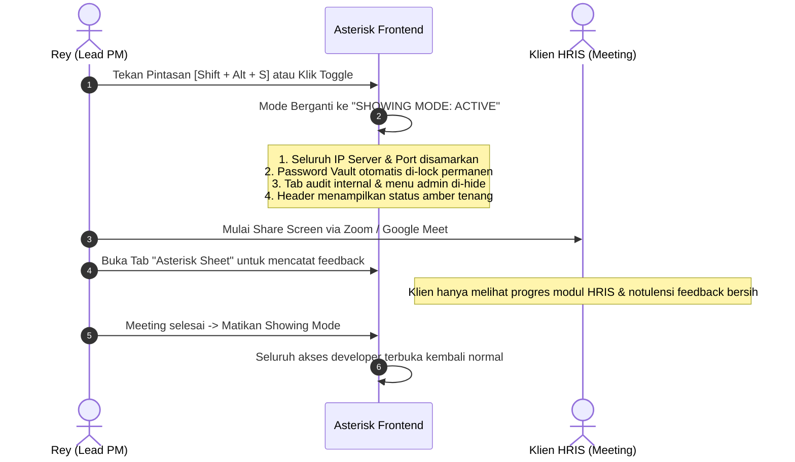
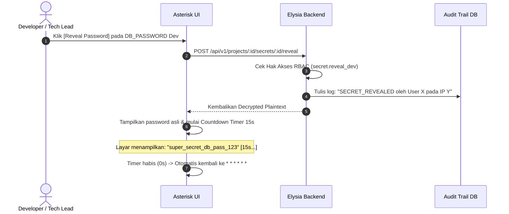
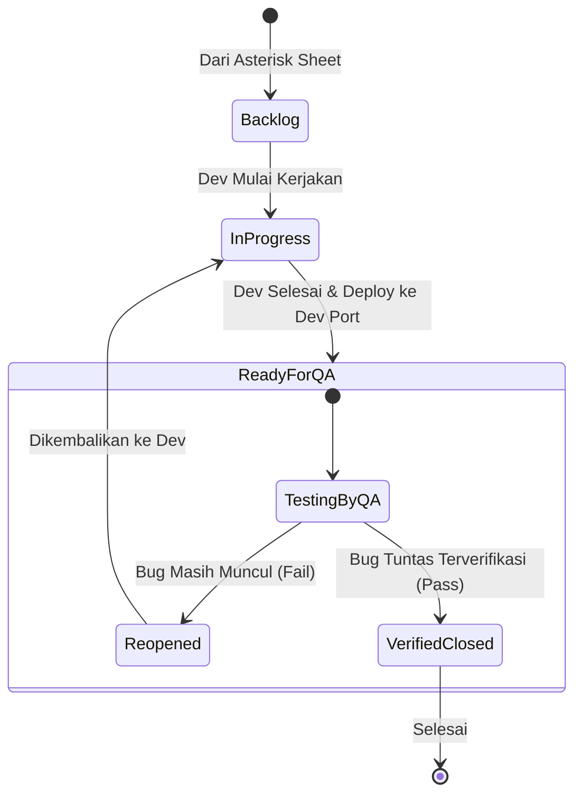

# Interactive User Flow & Wireframe Specification
## Project: ASTERISK (`*`)
**High-Density Console Design, Anti-"AI Slop" UI/UX Guidelines, & Journey Wireframes**

| Metadata | Detail |
| :--- | :--- |
| **Document Version** | 1.0.0 |
| **Design Philosophy** | Tactical Industrial / High-Density Dev Console (Linear + Vercel + Bloomberg Terminal feel) |
| **Primary Theme** | Deep Space Charcoal (`#090D16`) with Monospace Technical Accents |
| **Key Identity Marker** | Dynamic Asterisk (`*`) State Engine & One-Click "Showing Mode" |
| **Interaction Target** | Keyboard-First Navigation (Low Latency, Zero Friction) |

---

## 1. Brand Identity & Anti-"AI Slop" Manifesto

Banyak aplikasi modern yang dibuat dengan template AI menghasilkan **"AI Slop"**:
- ❌ *Gradient ungu/indigo generik* yang melelahkan mata.
- ❌ *Card raksasa dengan padding berlebihan* yang membuang ruang layar dan hanya menampilkan 3 baris data.
- ❌ *Modal pop-up bertingkat-tingkat* yang memperlambat pekerjaan meeting PM.

### Karakter Khas Asterisk:
1. **High Information Density**: Dirancang untuk Project Manager dan Developer yang butuh melihat status 10+ proyek atau 30+ baris feedback dalam 1 layar tanpa harus terus-menerus scroll.
2. **Tactical Dark Palette**: Warna dasar gelap pekat (*OLED/Charcoal*) dipadukan dengan tipografi *Monospace* (`JetBrains Mono` / `Geist Mono`) untuk data port, IP server, dan ID tiket.
3. **The Asterisk (`*`) Micro-Interactions**:
   - `*` Berdenyut hijau (*Emerald Pulse*): Sistem normal & server up.
   - `*` Berubah kuning (*Amber Glow*): Sesi Showing Mode sedang aktif.
   - `* * * * * *`: Masking password custom dengan gaya taktikal, bukan sekadar bulatan hitam browser standar.
4. **Keyboard-First Ergonomics**: Segala aksi kritis memiliki pintasan keyboard (`Cmd+K`, `Shift+Alt+S`, `N` untuk baris baru).

---

## 2. Palet Warna & Tipografi

```
Background Primary   : #080B11 (Obsidian Void)
Surface Level 1      : #0F172A (Deep Slate Card)
Surface Level 2      : #1E293B (Elevated Table Cell / Hover)
Border Subtle        : #334155 (Crisp 1px hairline border)

Accent Primary       : #F59E0B (Industrial Amber - Simbol Tanda Asterisk & Alert)
Accent Safe / QA Pass: #10B981 (Terminal Emerald)
Accent Critical / Bug: #EF4444 (Crimson Red)
Accent Focus / Dev   : #38BDF8 (Cyan Monospace)

Typography           : Sans-serif (Geist / Inter) untuk label;
                       Monospace (JetBrains Mono) untuk Port, IP, Secrets, & Timestamps.
```

---

## 3. Global Navigation Layout

```
+-------------------------------------------------------------------------------------------------------------------------+
| [*] ASTERISK   [ Project: HRIS PT Maju Jaya (MJY) v ]  [Search Cmd+K]       [🛡️ SHOWING MODE: OFF]   [Rey (PM) *] |
+-------------------------------------------------------------------------------------------------------------------------+
| [NAV]               | [MAIN VIEWPORT]                                                                                   |
|                     |                                                                                                   |
|  * Overview         |                                                                                                   |
|  * Vault & Secrets  |                                                                                                   |
|  * Asterisk Sheet   |                                                                                                   |
|  * QA & Tickets     |                                                                                                   |
|  * Environments     |                                                                                                   |
|  * Audit Trail      |                                                                                                   |
|  -----------------  |                                                                                                   |
|  * RBAC Settings    |                                                                                                   |
|                     |                                                                                                   |
+---------------------+---------------------------------------------------------------------------------------------------+
```

---

## 4. User Journey 1: "Showing Mode" (Safe Presentation Toggle)

Salah satu nilai jual terbesar Asterisk adalah kemampuan **Share Screen tanpa rasa cemas**.



### Wireframe Perbandingan: Normal Mode vs Showing Mode

#### Normal Mode (Tampilan PM & Developer Internal):
```
+--------------------------------------------------------------------------------------------------------------------+
| [VAULT & PORTS] - PT Maju Jaya HRIS                                                      [Showing Mode: [  OFF  ]] |
+--------------------------------------------------------------------------------------------------------------------+
| ENVIRONMENT | HOST / URL                    | GENERATOR PORT | DATABASE PASSWORD           | REPO BRANCH           |
+-------------+-------------------------------+----------------+-----------------------------+-----------------------+
| DEV         | 192.168.10.45                 | :3001 [Copy]   | * * * * * * [Reveal] [Copy] | main (commit a8f2)    |
| STAGING     | uat-hris.majujaya.com         | :8080 [Copy]   | * * * * * * [Reveal] [Copy] | staging (v3.2.0-rc1)  |
| PRODUCTION  | hris.majujaya.com             | :443  [Open]   | [LOCKED - PROD ACCESS REQ]  | release/v3.2.0        |
+--------------------------------------------------------------------------------------------------------------------+
```

#### Showing Mode Aktif (Aman untuk Share Screen di Depan Klien):
```
+--------------------------------------------------------------------------------------------------------------------+
| [PROJECT DELIVERABLES] - PT Maju Jaya HRIS                                               [🛡️ SHOWING MODE: [ ON ]] |
+--------------------------------------------------------------------------------------------------------------------+
| ENVIRONMENT | STATUS       | DEPLOYED MODULES                 | VERSION       | SOW PROGRESS                       |
+-------------+--------------+----------------------------------+---------------+------------------------------------+
| STAGING/UAT | [LIVE DEMO]  | Attendance, Payroll, Claims      | v3.2.0-rc1    | [====================80%---------] |
| PRODUCTION  | [SCHEDULED]  | Pending Final UAT Approval       | Target: Nov26 | Milestone 4 of 5                   |
+--------------------------------------------------------------------------------------------------------------------+
| ! Catatan: Seluruh port internal, IP host, dan konfigurasi rahasia disamarkan secara otomatis untuk keamanan sistem.|
+--------------------------------------------------------------------------------------------------------------------+
```

---

## 5. User Journey 2: Asterisk Sheet (Fast-Entry Feedback to Ticket)

Ketika meeting dengan klien, kecepatan mencatat adalah kunci. Tidak boleh ada popup lambat.

```mermaid
flowchart TD
    A["Mulai Sesi Showing Klien"] --> B["Buka Tab: Asterisk Sheet"]
    B --> C["Ketik Catatan Cepat (Keyboard Navigation)\nModul -> Tipe -> Catatan"]
    C --> D{"Apakah ada Bug / Request Baru?"}
    D -->|Tidak (Hanya Notulensi Biasa)| E["Tekan Enter: Baris Tersimpan"]
    D -->|Ya (Butuh Tindakan Dev)| F["Klik Tombol [-> Ticket] di Ujung Baris"]
    F --> G["Drawer Cepat Terbuka: Pilih Severity & Dev Assignee"]
    G --> H["Tiket Terbuat Otomatis di Kanban Dev & Terlink ke Baris Sheet!"]
```

### Wireframe: Asterisk Sheet (High-Density Table View)

```
+--------------------------------------------------------------------------------------------------------------------+
| [ASTERISK SHEET] Sesi: Showing Payroll Sprint 3 (04 Nov 2026)      [+ Baris Baru (N)] [Filter Modul v] [Export CSV]|
+----+-----------+----------------+---------------------------------------------------+----------------+-------------+
| #  | MODUL     | TIPE           | CATATAN FEEDBACK DARI KLIEN                       | STATUS         | ACTION      |
+----+-----------+----------------+---------------------------------------------------+----------------+-------------+
| 01 | PAYROLL   | [FEEDBACK  v]  | Klien minta tombol download slip gaji dibuat PDF  | [CONVERTED]    | -> Ticket #4|
| 02 | ATTENDANCE| [BUG       v]  | GPS radius absensi di mobile sering loncat 50m    | [OPEN]         | [-> Ticket] |
| 03 | MASTER    | [QUESTION  v]  | Apakah data cuti tahun lalu bisa di-carry over?   | [RESOLVED]     | [Edit]      |
| 04 | [Select v]| [FEEDBACK  v]  | [Ketik catatan feedback di sini...              ] | [OPEN]         | [Simpan]    |
+----+-----------+----------------+---------------------------------------------------+----------------+-------------+
```

---

## 6. User Journey 3: Encrypted Secrets Vault & Reveal Flow

Mencegah kebocoran kredensial dengan alur buka password berwaktu (*Time-bound Auto-mask*) dan pencatatan audit log otomatis.



### Wireframe: Vault Secret Card

```
+--------------------------------------------------------------------------------------------------------------------+
| SECRETS & CREDENTIALS VAULT - [Filter: Development Server v]                                     [+ Add Secret]    |
+--------------------------------------------------------------------------------------------------------------------+
| VARIABLE NAME       | CATEGORY    | VALUE / CIPHERTEXT              | LAST REVEALED BY    | ACTIONS                |
+---------------------+-------------+---------------------------------+---------------------+------------------------+
| DB_PASSWORD         | DATABASE    | * * * * * * * *                 | Rey (Today 20:15)   | [👁️ Reveal] [📋 Copy]  |
| GENERATOR_TOKEN     | API_AUTH    | * * * * * * * *                 | Budi (Yesterday)    | [👁️ Reveal] [📋 Copy]  |
| SSH_PRIVATE_KEY     | SERVER_SSH  | [RSA PRIVATE KEY - ENCRYPTED]   | Never               | [👁️ Reveal] [📋 Copy]  |
+---------------------+-------------+---------------------------------+---------------------+------------------------+
|                                                                                                                    |
| [Saat Tombol Reveal Diklik]:                                                                                       |
| DB_PASSWORD: "pg_hris_dev_pass_992!"  [⏳ Auto-hiding in 12s...]  [📋 Copy Plaintext]  [🔒 Hide Now]               |
+--------------------------------------------------------------------------------------------------------------------+
```

---

## 7. User Journey 4: Dynamic RBAC Matrix (Superadmin Configuration)

Halaman pengaturan izin dinamis yang mudah dikelola oleh Superadmin (Rey) untuk membuat role baru:

### Wireframe: Dynamic RBAC Permission Grid

```
+--------------------------------------------------------------------------------------------------------------------+
| RBAC CONFIGURATION: Role "Tech Lead"                                          [Save Changes] [Discard]             |
+--------------------------------------------------------------------------------------------------------------------+
| PERMISSION DOMAIN     | CAPABILITY / ACTION                                             | STATUS                   |
+-----------------------+-----------------------------------------------------------------+--------------------------+
| PROJECTS              | project.view   (Lihat ringkasan proyek)                         | [x] ALLOWED              |
|                       | project.create (Buat project baru)                              | [ ] DENIED               |
|                       | project.edit   (Ubah SOW & versi HRIS)                          | [x] ALLOWED              |
+-----------------------+-----------------------------------------------------------------+--------------------------+
| SECRETS & VAULT       | secret.view_dev_masked    (Lihat daftar secret dev)             | [x] ALLOWED              |
|                       | secret.reveal_dev         (Reveal password dev)                 | [x] ALLOWED (Audited)    |
|                       | secret.view_prod_masked   (Lihat daftar secret prod)            | [x] ALLOWED              |
|                       | secret.reveal_prod        (Reveal password production)          | [ ] DENIED (Protected)   |
+-----------------------+-----------------------------------------------------------------+--------------------------+
| ASTERISK SHEET        | sheet.row_create (Ketik feedback showing)                       | [x] ALLOWED              |
|                       | sheet.convert_ticket (Ubah feedback jadi tiket)                 | [x] ALLOWED              |
+-----------------------+-----------------------------------------------------------------+--------------------------+
| QA & TICKETING        | ticket.status_dev (Pindahkan ke In-Progress / Ready for QA)     | [x] ALLOWED              |
|                       | ticket.verify_qa  (Approve & Close bug fix)                     | [ ] DENIED (QA Only)     |
+--------------------------------------------------------------------------------------------------------------------+
```

---

## 8. User Journey 5: QA Verification Flow (Dual-Gate Delivery)

Memastikan siklus bug fix tidak langsung ditutup oleh developer tanpa validasi resmi QA:



### Wireframe: QA Action Bar pada Detail Tiket
```
+--------------------------------------------------------------------------------------------------------------------+
| TIKET: #MJY-042 - GPS radius absensi loncat 50m                    Status: [ READY FOR QA ]   Severity: [ HIGH ]   |
+--------------------------------------------------------------------------------------------------------------------+
| Assignee Dev: Alex (Frontend) | Assignee QA: Cindy (QA Specialist) | Source: Sheet "Showing Payroll Sprint 3"      |
|                                                                                                                    |
| DESKRIPSI PERBAIKAN DEV:                                                                                           |
| "Sudah ditambahkan debounce geolocation filter 5 detik di build generator port 3001. Silakan dicek."               |
+--------------------------------------------------------------------------------------------------------------------+
| [QA VERIFICATION GATEWAY] (Hanya aktif untuk Role QA / PM):                                                        |
| Catatan Verifikasi QA: [Ketik hasil pengujian di environment dev di sini...                                      ] |
|                                                                                                                    |
| [  ❌ REJECT & REOPEN (Kembalikan ke Dev)  ]          [  ✅ APPROVE & CLOSE (Lolos Verifikasi)  ]                  |
+--------------------------------------------------------------------------------------------------------------------+
```

---

## 9. Keyboard Shortcuts Index (Power-User Cheat Sheet)

| Pintasan Keyboard | Aksi | Konteks |
| :--- | :--- | :--- |
| `Shift + Alt + S` | **Toggle Showing Mode (On / Off)** | Global (Kapan saja saat meeting) |
| `Cmd / Ctrl + K` | Buka Command Palette (Cari project/tiket cepat) | Global |
| `N` | Buat baris baru di Asterisk Sheet | Halaman Asterisk Sheet |
| `Cmd / Ctrl + Enter` | Simpan baris sheet / Submit komentar tiket | Form / Table Cell |
| `Esc` | Tutup drawer / Batalkan fokus cell | Modal / Cell |

---

## 10. Summary Status
Dengan selesainya dokumen ini, arsitektur visual dan interaksi Asterisk telah memiliki ciri khas yang kuat:
- [x] Bebas dari "AI Slop" (desain padat, fungsional, industrial, berorientasi efisiensi PM).
- [x] Memiliki identitas khas **Asterisk** (`*` state engine, high-density sheet, dan *Showing Mode*).
- [x] Alur interaksi terpetakan jelas dari level presentasi klien hingga validasi QA.

