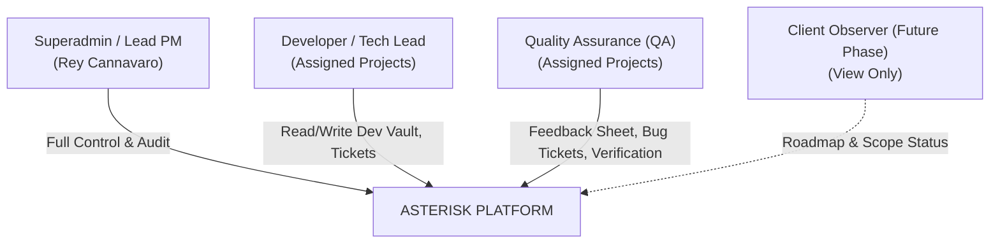
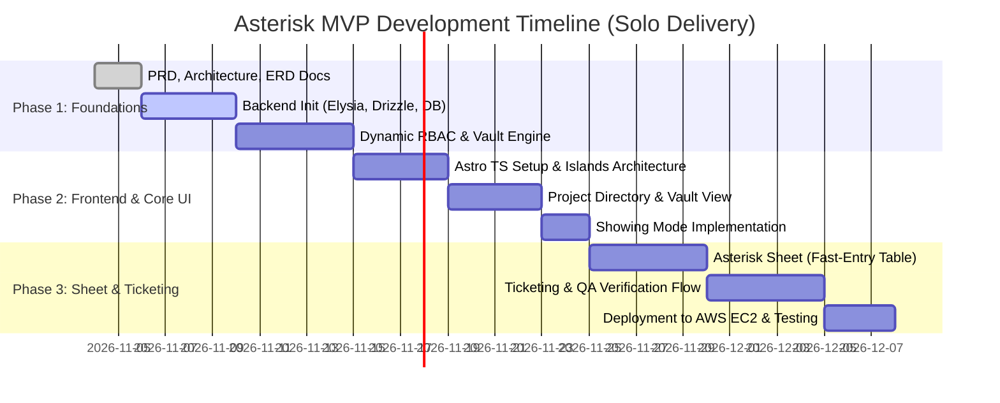

# Product Requirement Document (PRD) & Scope Boundary
## Project: ASTERISK (`*`)
**All-in-one System for Tracking Environments, Repositories, Issues, & Software Knowledge**

| Metadata | Detail |
| :--- | :--- |
| **Document Version** | 1.0.0 |
| **Status** | Approved / Ready for Execution |
| **Product Owner / Lead Architect** | Rey Cannavaro (Lead HRIS Project Manager) |
| **Target Runtime** | Bun + ElysiaJS (Backend), Astro TS + React Islands (Frontend) |
| **Infrastructure** | AWS EC2 + Docker (PostgreSQL, Nginx) |
| **Last Updated** | November 2026 |

---

## 1. Executive Summary & Vision

### 1.1 Product Vision
**Asterisk (`*`)** adalah *internal developer portal*, *secrets manager*, dan *delivery workspace* terpusat yang dirancang khusus untuk mengelola implementasi puluhan proyek **HRIS (Human Resource Information System)** lintas klien pada sebuah software vendor.

Simbol asterisk (`*`) merepresentasikan:
1. **Wildcard Operator (`*`)**: Titik temu tunggal (*single pane of glass*) untuk seluruh proyek, environment, tiket, dan catatan feedback HRIS klien.
2. **Pointer**: Penunjuk langsung ke generator ports, credential server, repositori GitHub, serta dokumen arsitektur tanpa harus mencari di spreadsheet atau riwayat obrolan pesan instan.

### 1.2 Core Value Proposition
- **Zero Scattered Credentials**: Port dev/staging/prod, generator config, dan password database tersimpan dalam *Encrypted Vault* yang aman dengan permission berbasis peran (*Dynamic RBAC*).
- **Fast-entry Feedback Logging**: Menghilangkan ketergantungan pada puluhan Google Sheets yang tercecer melalui *Asterisk Sheet* (tabel terstruktur bergaya Notion/Spreadsheet yang bisa dikonversi menjadi tiket tugas/bug dalam 1 klik).
- **Client Presentation Safety**: Fitur *Showing Mode* yang menyamarkan seluruh data sensitif (port & password) secara instan saat sesi *screen-sharing* dengan klien.
- **Unified Delivery Cycle**: Siklus feedback terpadu dari *Client Showing* &rarr; *Ticketing Dev* &rarr; *QA Verification* &rarr; *Deployment*.

---

## 2. Problem Statement & Root Cause Analysis

| No | Problem Statement (Gejala) | Root Cause (Akar Masalah) | Dampak Bisnis & Operasional |
| :--- | :--- | :--- | :--- |
| 1 | Akses dev, staging, prod, dan port generator tercecer di grup chat dan catatan lokal. | Tidak adanya *Internal Developer Portal* dan *Secret Store* terpusat khusus untuk tim HRIS. | Dev sering terhambat (*blocked*) karena harus menunggu PM/Lead memberikan password/port. Risiko kebocoran data klien. |
| 2 | Feedback klien saat sesi *showing* (UAT/demo mingguan) dan support tercecer di puluhan Google Sheets berbeda. | Format Google Sheets bebas, link spreadsheet hilang di riwayat obrolan, tidak ada relasi langsung ke tiket kerja developer. | Feedback klien terlewat, komplain berulang dari klien, sulit mengukur progress implementasi fitur secara nyata. |
| 3 | QA kesulitan melacak apakah bug sudah diperbaiki di server development atau belum. | Tidak ada alur verifikasi resmi antara tiket perbaikan bug dev dengan validasi QA. | Bug yang sama muncul kembali saat *showing* ke klien, menurunkan kredibilitas vendor. |
| 4 | Ketakutan membocorkan kredensial teknis saat *share screen* meeting dengan klien. | Sistem PM/Dev tradisional menampilkan URL teknis, IP server, dan port di layar kerja yang sama. | PM harus repot menutup tab dan menyalin data manual ke dokumen terpisah sebelum meeting. |

---

## 3. User Personas & Stakeholders

### 3.1 Superadmin (Lead Project Manager - Primary Actor)
- **Karakteristik**: Mengawasi seluruh siklus delivery puluhan project HRIS di perusahaan.
- **Kebutuhan**:
  - Melihat direktori seluruh klien beserta status kesehatannya (*On-Track, Delayed, Live, Maintenance*).
  - Mengelola *Dynamic RBAC* (menentukan role kustom dan izin granular per user).
  - Mengaktifkan *Showing Mode* saat presentasi ke klien.
  - Mengaudit siapa saja anggota tim yang membuka kredensial produksi (*Audit Log*).

### 3.2 Developer / Tech Lead
- **Karakteristik**: Fokus pada implementasi fitur HRIS (payroll, absensi, KPI) dan bug fixing.
- **Kebutuhan**:
  - Akses cepat (*one-click copy*) ke port generator, IP server, branch repo, dan password database staging/dev.
  - Menerima tiket bug yang jelas yang berasal dari feedback showing.
  - Memperbarui status task dari *In Progress* menjadi *Ready for QA*.

### 3.3 Quality Assurance (QA)
- **Karakteristik**: Menguji stabilitas modul HRIS sebelum dan sesudah rilis.
- **Kebutuhan**:
  - Membuka halaman *Asterisk Sheet* untuk mencatat temuan bug secara cepat selama sesi testing atau *showing*.
  - Mengonversi baris feedback menjadi tiket bug resmi.
  - Memverifikasi perbaikan dari developer (*Pass / Fail*) sebelum status tiket ditutup (*Closed*).

---

## 4. Scope Boundary (Batasan Ruang Lingkup)

Untuk menjamin eksekusi yang realistis dan sukses sebagai **Solo Developer**, batasan cakupan proyek didefinisikan secara tegas ke dalam **In-Scope (V1 MVP)** dan **Out-of-Scope (Future Enhancements)**.

### 4.1 In-Scope (Versi 1.0 - Core Engine)

#### Modul 1: Authentication & Dynamic Complex RBAC
- Autentikasi berbasis Session / JWT aman (HTTP-only cookies).
- **Dual-Level RBAC**:
  - **Global Role**: Superadmin vs General User.
  - **Project-Scoped Role**: Peran spesifik per project (misal: User A adalah *Lead Dev* di Proyek Klien X, tetapi tidak memiliki akses di Proyek Klien Y).
- Manajemen Role & Permission Dinamis:
  - Pembuatan role kustom secara fleksibel.
  - Matriks perizinan granular (*CRUD Projects, View Dev Secrets, View Prod Secrets, Reveal Passwords, Edit Sheets, Verify Tickets*).
- **Audit Trail System**: Pencatatan log otomatis setiap ada aksi kritis (terutama saat tombol *Reveal Password* ditekan).

#### Modul 2: Project & Environment Registry (The Vault)
- Katalog proyek HRIS per klien (Nama Klien, Kode Proyek, Versi HRIS, Status SOW, Target Go-Live).
- Manajemen Environment per Proyek:
  - **Development**: IP Host, Port Generator, URL Backend, URL Frontend, DB Name & Password.
  - **Staging / UAT**: Domain UAT, Generator Staging Port, DB Credentials.
  - **Production**: Live URL, Repo Release Branch, Production Notes.
- **Keamanan Secrets**: Kredensial password disimpan terenkripsi dengan algoritma **AES-256-GCM**.
- **Masking UI**: Password disensor secara default (`••••••••`) dengan tombol `Reveal` (terikat izin RBAC) dan `Copy`.

#### Modul 3: "Showing Mode" (Safe Presentation Toggle)
- Toggle global pada header: `[ Showing Mode: ACTIVE / INACTIVE ]`.
- Ketika status **ACTIVE**:
  - Semua port internal, IP server, password database, branch teknis, dan token rahasia disembunyikan/disamarkan secara permanen di UI.
  - Hanya menampilkan Nama Proyek, Progress Bar, Daftar Modul HRIS, dan Halaman Asterisk Sheet untuk input feedback.

#### Modul 4: Asterisk Sheet (Fast-Entry Feedback Logger)
- Antarmuka tabel interaktif berbasis baris (mirip spreadsheet terstruktur/Notion database).
- Input cepat tanpa modal pop-up:
  - Kolom: `Timestamp`, `Modul HRIS` (Attendance, Payroll, Claim, dll.), `Tipe` (Feedback, Bug, Pertanyaan Klien, Change Request), `Catatan Detail`, `Action`.
- Fitur **1-Click Convert to Ticket**: Mengubah satu baris catatan feedback langsung menjadi tiket tugas developer.

#### Modul 5: Ticket & QA Verification Board
- Papan status pekerjaan sederhana namun fungsional:
  1. `Backlog`
  2. `In Progress (Dev)`
  3. `Ready for QA`
  4. `Verified & Closed (QA)`
- Alur verifikasi: Developer tidak bisa mengubah status tiket menjadi *Closed*; hanya role dengan izin QA yang dapat melakukan *Verify & Close*.

---

### 4.2 Out-of-Scope (Ditunda untuk Versi 2.0+)
Hal-hal berikut **DILARANG** diimplementasikan pada V1 untuk mencegah pembengkakan waktu pengembangan (*scope creep*):
- ❌ Kloning rumus Excel (VLOOKUP, SUM, formula matematika pada Asterisk Sheet).
- ❌ Real-time collaborative multi-cursor ala Google Docs (cukup REST API polling / optimistic updates).
- ❌ Billing, invoicing, dan modul komersial klien.
- ❌ Integrasi CI/CD Runner mandiri (deploy runner otomatis). Cukup menyimpan URL & status.
- ❌ Mobile Application (Asterisk V1 murni Web-responsive untuk Desktop/Laptop).

---

## 5. Functional Requirements (FR)

### 5.1 RBAC & User Management (FR-AUTH)
- **FR-AUTH-01**: Pengguna dapat login menggunakan kombinasi email dan password terenkripsi (Argon2id/bcrypt).
- **FR-AUTH-02**: Superadmin dapat membuat Role baru dengan memilih permission dari daftar matriks permission.
- **FR-AUTH-03**: Superadmin dapat mengaitkan pengguna ke project tertentu dengan role yang berbeda antar project (*Project Member Assignment*).
- **FR-AUTH-04**: Backend Elysia harus memvalidasi permission sebelum mengembalikan data sensitif (Dev Secret vs Prod Secret).

### 5.2 Environment & Secrets Vault (FR-VAULT)
- **FR-VAULT-01**: Sistem harus mengenkripsi field password sebelum disimpan ke database menggunakan *Master Key* environment.
- **FR-VAULT-02**: Saat user menekan tombol `Reveal Password`, sistem melakukan verifikasi hak akses dan mencatat entri ke tabel `audit_logs` (User ID, Project ID, Timestamp, IP).
- **FR-VAULT-03**: Tombol `Copy to Clipboard` tersedia di setiap port generator, URL repo, dan credential.

### 5.3 Asterisk Sheet (FR-SHEET)
- **FR-SHEET-01**: Halaman sheet harus mendukung navigasi keyboard cepat (Enter untuk baris baru, Tab untuk pindah cell).
- **FR-SHEET-02**: Setiap baris sheet memiliki dropdown pemilihan modul HRIS (fleksibel dikonfigurasi per project).
- **FR-SHEET-03**: Pengguna dapat menekan tombol `Convert to Ticket` pada baris tertentu, yang otomatis membuat tiket dengan referensi ID baris sheet tersebut.

### 5.4 Showing Mode (FR-SHOW)
- **FR-SHOW-01**: Tombol toggle *Showing Mode* dapat diaktifkan/dinonaktifkan dalam 1 klik tanpa perlu reload halaman.
- **FR-SHOW-02**: Ketika aktif, elemen berlabel rahasia (secrets/ports) diberi filter blur/penghapusan dari DOM client-side.

### 5.5 Ticketing & QA (FR-TICK)
- **FR-TICK-01**: Tiket bug wajib menyertakan: Judul, Modul HRIS, Severity (*Low, Medium, High, Blocker*), Deskripsi/Langkah Reproduksi, Assignee Dev, dan Assignee QA.
- **FR-TICK-02**: Developer hanya dapat memindahkan tiket ke status *Ready for QA*.
- **FR-TICK-03**: QA dapat melakukan *Reopen* (jika bug masih muncul) atau *Approve & Close*.

---

## 6. Non-Functional Requirements (NFR)

### 6.1 Performance & Responsiveness
- Waktu respon API backend ElysiaJS di bawah **50 ms** untuk operasi pembacaan data standar.
- Initial load time frontend Astro di bawah **1.5 detik** pada koneksi internet standar kantor/klien.

### 6.2 Security & Data Protection
- Seluruh lalu lintas data diwajibkan menggunakan HTTPS (SSL/TLS via Nginx reverse proxy).
- Enkripsi simetris data at rest untuk password server menggunakan **AES-256-GCM**.
- Secret Key Master tidak pernah disimpan di repository Git, melainkan melalui variabel *Environment* EC2.
- Perlindungan terhadap serangan umum: CSRF Protection, CORS restriction, Rate Limiting pada endpoint login dan reveal secret.

### 6.3 Reliability & Availability (AWS EC2)
- Sistem berjalan di atas container Docker dengan kebijakan restart otomatis (`restart: unless-stopped`).
- Mekanisme script backup otomatis harian untuk database PostgreSQL ke direktori terisolasi atau AWS S3.

---

## 7. Success Metrics & Key Performance Indicators (KPIs)

1. **Zero Blocked Dev Time**: Mengeliminasi waktu tunggu developer untuk mendapatkan port dan kredensial server hingga **0 menit** (semua tersedia mandiri di Asterisk).
2. **100% Showing Feedback Captured**: Tidak ada lagi feedback atau komplain showing klien yang hilang akibat tautan spreadsheet yang tercecer.
3. **Zero Credential Leaks**: Tidak ada kebocoran kredensial internal saat sesi *screen-sharing* dengan klien berkat *Showing Mode*.
4. **Resolution Speed**: Penurunan waktu siklus dari feedback showing hingga verifikasi QA minimal **40%**.

---

## 8. Release Roadmap (Phased Execution)

---

## 9. Sign-off & Next Steps

Dengan disetujuinya dokumen PRD & Scope Boundary ini, tahapan perancangan teknis berikutnya yang akan dikerjakan adalah:
1. **Penyusunan RBAC Matrix & Security Specification** (`docs/02-RBAC-and-Security-Spec.md`).
2. **Penyusunan Database Architecture & ERD** (`docs/03-Database-Design-and-ERD.md`).
3. **Inisialisasi Project Repository & Scaffolding Backend Elysia + Frontend Astro**.

